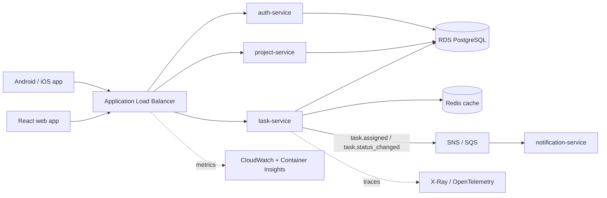

<TLDR>
TaskFlow is a fictional task-management app. Every example in this handbook uses it. Its architecture and rules
below are fixed, so examples stay consistent. A small version runs on your laptop in `examples/taskflow/`.
</TLDR>

## Production architecture (reference only)

This is the architecture the examples assume. Nobody has to deploy it to learn from the handbook.



| Part | Choice |
|---|---|
| Clients | React web app; Android and iOS app |
| Edge | AWS Application Load Balancer (ALB) |
| Services | `auth-service`, `task-service`, `project-service`, `notification-service`. Each runs as containers on **ECS Fargate** |
| Data | **RDS PostgreSQL**; **Redis** cache |
| Async | `task.assigned` and `task.status_changed` events via **SNS/SQS**, consumed by `notification-service` |
| Observability | **CloudWatch** + Container Insights; **X-Ray / OpenTelemetry** traces |

## Business rules

These rules are used for test-design examples. Do not change them.

| Rule | Detail |
|---|---|
| Title | 1 to 100 characters |
| Priority | One of `LOW`, `MEDIUM`, `HIGH` |
| Status flow | `TODO` → `IN_PROGRESS` → `IN_REVIEW` → `DONE`. Allowed step-backs: `IN_PROGRESS` → `TODO` and `IN_REVIEW` → `IN_PROGRESS`. `DONE` → `REOPENED` → `IN_PROGRESS`. Any other move is rejected (409) |
| Assignment | Only project members can be assigned to a task (422 otherwise) |
| Access | You must be a project member to see or change its tasks (403 otherwise) |

## Core API

| Method | Path | Purpose |
|---|---|---|
| POST | `/api/auth/login` | Log in, get a token |
| POST | `/api/projects` | Create a project |
| POST | `/api/tasks` | Create a task |
| GET | `/api/tasks/{id}` | Read a task |
| PUT | `/api/tasks/{id}` | Change title, priority or status |
| DELETE | `/api/tasks/{id}` | Delete a task |
| POST | `/api/tasks/{id}/assign` | Assign a task to a project member |

## Run the local version

The local version (`examples/taskflow/`) has the same API and rules. It uses SQLite by default, or Postgres with
`docker compose up`. It has **no** SQS, Redis, ECS or ALB.

```bash
cd examples/taskflow
python3 -m venv .venv && . .venv/bin/activate
pip install -r requirements-dev.txt
uvicorn app.main:app --reload      # UI: http://localhost:8000  API docs: http://localhost:8000/docs
pytest -q                          # the offline suite: 94 tests (19 of them in test_taskflow_api.py)
```

Demo users: `alice / alice-pass` and `bob / bob-pass`. Project `1` is "Demo project".

## Sample data rule

Any numbers, timings or reports that use TaskFlow data must be labelled **Illustrative data**. Those numbers are
examples, not measurements.
