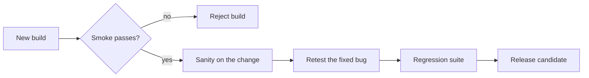

<TLDR>
Smoke testing asks "is this build alive?". Sanity testing asks "does this one change basically work?". Retesting asks "is that bug really fixed?". Regression testing asks "did the change break anything else?". They differ in scope and in the question they answer.
</TLDR>

## What and why

Teams use these four words loosely, so people talk past each other. A shared meaning saves arguments in stand-ups and in pipeline design. For the wider map of levels and types, see Test levels and test types.

| Term | Plain-English question | Scope | Typical size | Usually automated? |
|---|---|---|---|---|
| Smoke | Is the build alive enough to test at all? | Broad and shallow, the critical paths only | A few minutes | Yes |
| Sanity | Does this specific change work at a basic level? | Narrow and shallow, around one change | Minutes | Often manual or a handful of checks |
| Retest (confirmation) | Is this exact defect fixed? | One failed test, re-run | Seconds | Yes, if the failing test was automated |
| Regression | Did the change break existing behaviour? | Broad, many existing tests | Minutes to hours | Yes, this is the main use of automation |

Note: some sources define sanity and smoke the other way round. ISTQB defines retesting (confirmation testing) and regression testing. "Smoke" and "sanity" are common industry terms, so agree on your team's meaning.

## How it works



The order goes from cheapest to most expensive. Each step protects the next: do not spend an hour of regression on a build that cannot start.

## When to run each

| Run it | When |
|---|---|
| Smoke | On every build or deployment, including after deploying to a test environment |
| Sanity | After a small fix or tweak, before spending time on a full run |
| Retest | After a developer says a defect is fixed |
| Regression | Before a release, and on every merge for the automated part. See CI/CD and continuous testing |

Regression suites grow with the product. Choose what to include using risk and Test coverage, not "everything".

## TaskFlow example

The 19 tests in `examples/taskflow/tests/test_taskflow_api.py` can play different roles.

**Smoke (run on every deploy, about 4 tests):**
`test_login_with_correct_password_returns_token`, `test_valid_priorities_are_accepted` (create works), `test_assign_a_member_works`, `test_deleted_task_is_gone`. Together they prove login, create, change and delete are alive. A real deployment can also call `GET /health`.

**Retest after a fix:** suppose a bug says "a task can jump from TODO to DONE". After the fix you re-run `test_skipping_a_step_is_409` first. It is the test that failed.

**Sanity after the fix:** also try one nearby path by hand, such as TODO to IN_PROGRESS.

**Regression:** then run all 19. The status fix touches shared code, so title, priority and membership tests might fail by accident.

```bash
cd examples/taskflow
pytest -q -k "skipping_a_step"   # retest
pytest -q                        # regression
```

Recommendation: tag smoke tests with a pytest marker, such as `@pytest.mark.smoke`, and run `pytest -m smoke` first in the pipeline.

## Do this

- Keep the smoke set tiny and fast, so people never skip it.
- Retest the exact failing case first, then run regression.
- Add an automated test for every fixed bug, so the fix joins the regression suite.
- Write down your team's definitions of smoke and sanity.

## Avoid this

- Calling a full regression run "a smoke test".
- Closing a bug after the retest passes without any regression run.
- Letting the regression suite grow without pruning slow or duplicate tests.
