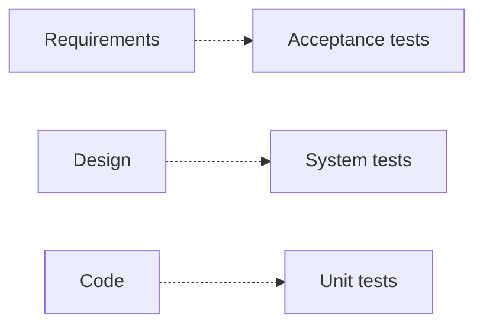
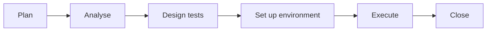

<TLDR>
The software development life cycle (SDLC) is the set of steps for building software, from requirements to maintenance. The software testing life cycle (STLC) is the set of steps testers follow inside it. Testing starts early, not at the end.
</TLDR>

## What and why

The **SDLC** describes how a product moves from idea to release. Common steps are requirements, design, build, test, release and maintenance. Teams use different models, such as waterfall, the V-model or agile, but all of them include these steps.

The **STLC** describes the testing work. Its steps are usually planning, analysis, design, environment setup, execution and closure. Names and order vary between teams, so treat this as a common model, not a standard.

Testing is not only the step after coding. Testers can check requirements and designs before any code exists.

## How it works

In the V-model, each development step has a matching test step. The test plan for each level is written early, while the matching development step is happening.

The STLC is a sequence of testing steps:

## When to use it (and when not to)

| Use this view when | Skip the detail when |
|---|---|
| You join a team and need to know where testing happens | You work on a small project with a short feedback loop |
| You plan testing for a release | You only need to run one test |
| You talk to managers about testing timing | Your team already has an agreed process you follow |

## TaskFlow example

Suppose the team adds the rule "a task can be assigned only to a project member".

- **SDLC:** the requirement is written, the API is designed, the code is built, then the feature is released.
- **STLC:** a tester plans tests for the rule, designs the cases (member and non-member), sets up two users in a project, runs the tests, and closes the testing with a summary.

Testing starts when the requirement is written. A tester who reads the requirement early can ask "what if the assignee is not in the project?" before the code is written.

## Do this

- Join the requirement discussions, not only the test phase.
- Write test ideas as soon as a requirement is clear.
- Keep your STLC steps visible, so others can see where testing stands.
- Match your test levels to your development model.

## Avoid this

- Waiting until the code is "finished" before you start testing.
- Using one model's rules for every project.

## Further reading

See [Test levels and test types](/fundamentals/test-levels-and-types) for what each test level checks.
