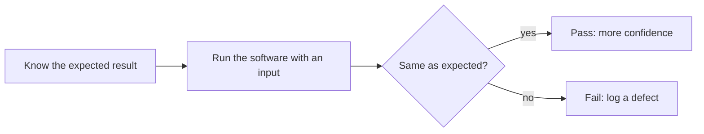

<TLDR>
Software testing checks that software does what it should, and finds problems before users do. A test cannot prove that software is bug-free. It gives you evidence for a release decision.
</TLDR>

## What and why

A **test** compares what the software does with what it should do. You give it an input, you know the expected result, and you check the two match.

When they do not match, you have found a **defect**: a flaw in the code or the design. When the software behaves wrongly while it runs, that is a **failure**. Testing helps teams find defects early, decide if a release is safe, and see where the risks are.

## How it works

Every test follows the same loop:

## The seven testing principles

These come from the ISTQB syllabus, the most common testing certification body:

1. Testing shows that defects are present. It cannot show that they are absent.
2. Exhaustive testing is impossible, so you must choose what to test.
3. Early testing saves time and money.
4. Defects cluster together. A buggy area often has more bugs.
5. The pesticide paradox: the same tests, repeated forever, stop finding new bugs.
6. Testing depends on context. A bank app and a game are tested differently.
7. Finding no bugs does not mean the software is useful. It may still be the wrong product.

## When to use it (and when not to)

| Use testing when | Testing alone is not enough when |
|---|---|
| You need evidence before a release | You need to know if users want the feature (use validation, see the next chapter) |
| You change code that others depend on | The code has no clear expected result |
| You want to find problems early | You expect testing to make the code good by itself |

## TaskFlow example

The TaskFlow rule is: a task title must be 1 to 100 characters (see [the TaskFlow reference](/start-here/taskflow-reference)).

A test sends a 101-character title and expects the API to refuse it with status 422. If the API accepts it, you have found a defect. The local suite has this check in `examples/taskflow/tests/test_taskflow_api.py`.

## Do this

- Decide what "correct" means before you run a test.
- Tie each test to a rule or a requirement.
- Report what you found, not only "pass" or "fail".
- Treat testing as a way to learn about risk.

## Avoid this

- Believing that a green test run means there are no bugs.
- Testing only the happy path, where everything goes right.

## Further reading

- [ISTQB Certified Tester Foundation Level](https://istqb.org/certifications/certified-tester-foundation-level-ctfl-v4-0/): the syllabus source for the principles (page checked on 2026-11-06).
