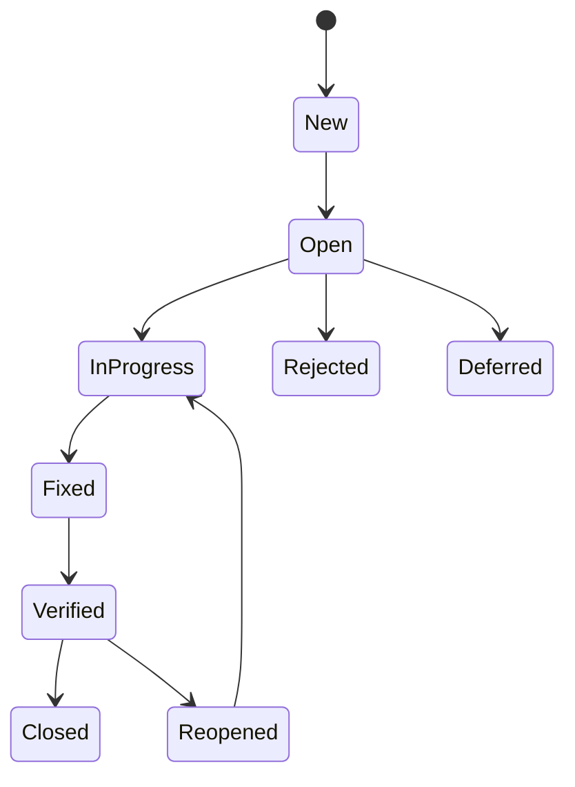

<TLDR>
A defect moves through a life cycle, from the first report to closure. A good report lets a developer reproduce the problem without asking you anything. Keep severity (how bad it is) and priority (when to fix it) as two separate fields.
</TLDR>

## What and why

A **defect** is a difference between what the software does and what it should do. Defect management is the process for tracking each one until it is fixed and checked.

Good defect management keeps defects from getting lost, and shows the team which problems are still open before a release.

## How it works

The exact states vary by tool. A common set:



| Field | Meaning |
|---|---|
| Severity | How much harm the defect does to the system or user |
| Priority | How soon the team should fix it |

These can differ. A typo on the login page may be low severity but high priority. A crash in a rarely used report may be high severity but low priority.

Recommendation: a report should include the steps to reproduce, the expected result, the actual result, the build version and the evidence (a screenshot, a log or a response body).

## When to use it (and when not to)

| Use a full report when | A short note is enough when |
|---|---|
| The defect is not obvious | The fix is one line and you are working with the developer now |
| It is found late or in production | It is a known issue already on the list |

## TaskFlow example

While checking the local TaskFlow API, a tester found that a title made of spaces is accepted. A report might look like this:

```text
Title: Task title of only spaces is accepted
Build: examples/taskflow, checked 2026-11-06
Steps: POST /api/tasks with title "     " (5 spaces), priority MEDIUM, project_id 1
Expected: 422, or the title is treated as empty (the rule says 1 to 100 characters)
Actual: 201 Created, task is saved with a title of 5 spaces
Severity: Medium (a task with no visible name)
Priority: To be agreed with the product owner
```

The defect may also be a question about the rule. Whether spaces count as a character is a product decision. The report asks for that decision, instead of guessing.

## Do this

- Write one defect per report.
- Include the build version and the exact input you used.
- Set severity from the impact, and set priority with the product owner.
- Re-test the fix yourself before you close the defect.

## Avoid this

- Writing "it does not work" with no steps.
- Reopening closed defects by mistake, because the fix was not checked on the same build.
- Using priority as a way to argue about severity.

## Further reading

Entry and exit criteria often use open defect counts. See [Entry and exit criteria](/planning-strategy/entry-and-exit-criteria).
