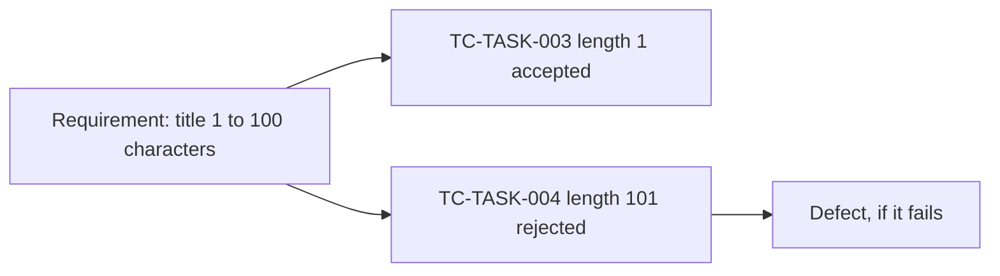

<TLDR>
A test case is one specific check with data, steps and an expected result. Good ones test one condition, have a clear name, and trace back to a requirement. Then you can answer "which tests cover this rule?" in seconds.
</TLDR>

## What and why

Test design techniques tell you which inputs to try. A test case is how you write one of them down so that anyone, or any machine, can run it the same way. Vague test cases give different results for different people.

## Anatomy of a good test case

| Part | What goes in it |
|---|---|
| ID | A stable identifier, such as `TC-TASK-004` |
| Title | What is checked and the expected outcome |
| Requirement link | The rule or story it covers |
| Preconditions | State needed before the test, such as a logged-in user |
| Steps and data | Exact actions and exact input values |
| Expected result | An observable outcome, such as a status code and a field value |
| Priority | How much it matters if it fails |

Use the full layout in Template: test case.

## Good versus bad

| Bad | Good |
|---|---|
| "Test the task title" | "TC-TASK-004: Creating a task with a 101-character title returns 422" |
| Steps: "Enter a long title" | Steps: log in as alice, `POST /api/tasks` with a title of 101 `a` characters, priority `LOW`, project 1 |
| Expected: "It should fail properly" | Expected: status 422 and no task is created |

## Naming and one condition per test

Name tests by behaviour: `test_task_title_of_101_characters_is_rejected`. A reader should know what broke from the name alone.

Test one condition at a time. If one test checks a bad title, a bad priority and a forbidden status move, a failure does not tell you which rule broke. TaskFlow's existing tests do this: title boundaries, priorities and status moves are separate tests.

## Traceability from requirement to test

Traceability means you can follow a line from a requirement to its tests, and back. It shows gaps (a rule with no test) and orphans (a test for no rule). See Requirements and testability for writing testable rules, and Template: traceability matrix for the layout.

## TaskFlow example

| Requirement (TaskFlow rule) | Test cases |
|---|---|
| Title is 1 to 100 characters | `test_task_title_length_boundaries` with lengths 0, 1, 100, 101 |
| Priority is LOW, MEDIUM or HIGH | `test_valid_priorities_are_accepted`, `test_invalid_priorities_are_rejected` |
| Status follows the flow; other moves return 409 | `test_status_follows_the_allowed_path`, `test_skipping_a_step_is_409` |
| Only members can be assigned (422) | `test_only_project_members_can_be_assigned`, `test_assign_a_member_works` |

Reading the table, a gap stands out: no test covers the step-back `IN_REVIEW` to `IN_PROGRESS`, or `DONE` to `TODO` being rejected. That is what traceability is for. For the boundary choices, see Equivalence partitioning and boundary values.

## Do this

- Write the expected result before you run the test.
- Use exact data, not "a long title".
- Put the requirement ID in the test name or a marker, so tools can build the matrix.
- Review test cases like code.

## Avoid this

- Steps that depend on another test having run first.
- Expected results such as "works correctly".
- Keeping a traceability matrix by hand in a spreadsheet that nobody updates.
