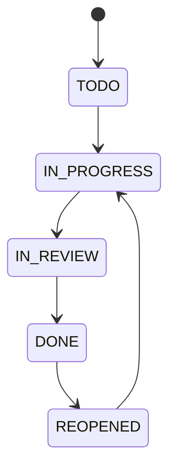

<TLDR>
State transition testing checks how an item moves between states, such as a task going from TODO to DONE. You test every allowed move, and you test that the blocked moves are refused. It is the right technique for any workflow with stages.
</TLDR>

## What and why

Many features have stages. An order is placed, shipped and delivered. A task is to-do, in progress and done. What the system does next depends on the current state.

A **state transition** test checks two things:

- Each allowed move works and lands in the right state.
- Each blocked move is refused, and the state does not change.

## How it works

TaskFlow status flow, from the reference page:

Any other move is blocked and returns 409 Conflict, according to the reference.

:::warning
The local app also accepts two backward moves that the reference does not list: `IN_PROGRESS` to `TODO`, and `IN_REVIEW` to `IN_PROGRESS`. Both return 200 in the current code. Confirm with the product owner which behaviour is intended, then either update the reference or change the code. Do not write a test that assumes either answer until that is decided.
:::

## When to use it (and when not to)

| Use it when | Skip it when |
|---|---|
| The item has stages with rules between them | The item has no stages, such as a plain text field |
| A wrong move would cause a real problem | The states are only labels with no rules |
| Users can move items in more than one way | You are testing a single screen with no state |

## TaskFlow example

Two tests in `examples/taskflow/tests/test_taskflow_api.py` cover the status flow:

- `test_status_follows_the_allowed_path` walks the allowed path, from `IN_PROGRESS` through `IN_REVIEW`, `DONE`, `REOPENED` and back to `IN_PROGRESS`.
- `test_skipping_a_step_is_409` tries to go from `TODO` straight to `DONE`, and expects 409.

To extend the coverage, add a row for each blocked move from the reference. For example, `DONE` to `IN_PROGRESS` should be 409, because `DONE` may only move to `REOPENED`. Check the response and then `GET /api/tasks/{id}` to confirm the status did not change.

## Do this

- Draw the states and arrows before you write any test.
- Test each allowed move, and the important blocked moves.
- After a blocked move, read the item back and check the state did not change.
- Test the path of the workflow end to end once, then test single moves.

## Avoid this

- Testing only the happy path. The blocked moves are where the bugs usually hide.
- Assuming the diagram is right. Check it against the code and the requirement.

## Further reading

For the rules that decide each move, see [Decision table testing](/test-design/decision-tables).
