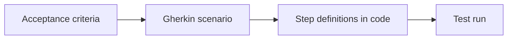

<TLDR>
Acceptance testing checks that the software meets the business need, using agreed acceptance criteria. Behaviour-driven development (BDD) writes those criteria as Given/When/Then scenarios that people and tools can both read. It helps when business people take part. It hurts when it is only a wrapper around tests developers write alone.
</TLDR>

## What and why

**Acceptance criteria** are the conditions a story must meet to be accepted. **User acceptance testing (UAT)** is when business users or their representatives confirm the product fits their need. This is validation, as explained in Verification vs validation.

## How it works: Gherkin

Gherkin is a plain-text format with keywords:

- **Given**: the starting state.
- **When**: the action.
- **Then**: the expected outcome.
- **And**: continue any of the above.



Each line of the scenario is matched to a Python function (a step definition).

## When BDD helps, when it hurts

| Helps | Hurts |
|---|---|
| Product owner, tester and developer write scenarios together | Only testers write them, nobody else reads them |
| Rules are unclear and examples settle arguments | Rules are technical, such as boundary values (use plain parametrised tests) |
| Scenarios double as living documentation | Hundreds of scenarios become slow and hard to maintain |

Recommendation: use BDD for a few key business rules. The value is the conversation. The tool is secondary.

## TaskFlow example

The rule: only project members can be assigned to a task. Files are in `examples/taskflow/bdd/`.

```gherkin
Scenario: Assign a task to someone who is not a member of the project
  Given alice is logged in
  And a task exists in a project that only alice belongs to
  When alice assigns the task to bob
  Then the response status is 422
  And the task has no assignee
```

The steps file `test_assign_task.py` uses the FastAPI `TestClient`, like the API tests.

```python
from pytest_bdd import given, parsers, scenarios, then, when
scenarios("assign_task.feature")

@when(parsers.parse("alice assigns the task to {name}"), target_fixture="response")
def assign(client, headers, task_id, name):
    return client.post(f"/api/tasks/{task_id}/assign", headers=headers,
                       json={"user_id": USER_IDS[name]})

@then(parsers.parse("the response status is {code:d}"))
def check_status(response, code):
    assert response.status_code == code, response.text
```

The pytest-bdd functions used here (`scenarios()`, `given/when/then`, `parsers.parse` and `target_fixture`) come from the pytest-bdd docs. Installed version: pytest-bdd 9.0.1. The docs consulted were for 8.1.0, and these functions are the same in both.

Real result, run on 2026-11-06 from `examples/taskflow`:

```text
$ pytest bdd -q
..                                                                       [100%]
2 passed, 1 warning in 1.48s
```

The warning is an upstream deprecation notice from Starlette's test client, not from the example.

## Do this

- Write scenarios with the people who own the rule.
- Keep each scenario about one business behaviour, in business words.
- Reuse step definitions across scenarios.

## Avoid this

- Putting HTTP details (URLs, JSON) in the Gherkin text.
- Using BDD for every test just because the tool is installed.
- Skipping UAT because automated scenarios pass: users may still reject the result.
