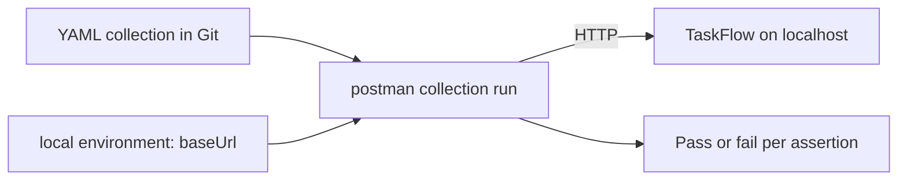

<TLDR>
The Postman CLI runs a Postman collection from a terminal. A collection is a set of saved HTTP requests with test scripts. TaskFlow has a small one in `examples/taskflow/postman/`. It ran against a local server here without any login. It is a good fit when people already think in requests, and less so when your team lives in pytest.
</TLDR>

## What and why

The earlier page on [API testing](/testing-by-layer/api-testing) uses pytest and httpx. This page shows the same kind of checks in Postman's format. Teams use it when testers, developers and support staff share the same saved requests.

A **collection** is a folder of requests. Each request can hold a script that runs after the response and calls `pm.test(...)`. The **Postman CLI** (version 1.73.0 on the machine used here) runs those scripts from the command line, so they can run in CI.

## How it works

The collection is stored as plain YAML files (Postman's "v3" local format). They diff and review like code. The request that logs in saves the token into a collection variable. Later requests send it as a bearer token.



## When to use it (and when not to)

| Use it when | Skip it when |
|---|---|
| Non-programmers need to read or edit the checks | The team already has pytest suites and wants one place for tests |
| You want the same requests for manual exploration and for CI | You need complex data setup or shared Python helpers |
| You want to send results to Postman's cloud (needs login, not done here) | Nothing may leave the machine and you do not want to review CLI behaviour |

## TaskFlow example

The files are in `examples/taskflow/postman/`: five requests in `collections/taskflow-api/` and an environment `environments/local.environment.yaml` with `baseUrl`. The requests are login, create task, title of 100 characters (accepted), title of 101 characters (rejected with 422) and create without a token (401). Both linters reported no issues:

```bash
postman collection lint postman/collections/taskflow-api
postman environment lint postman/environments/local.environment.yaml
```

Start TaskFlow, then run the collection. The environment file says port 8000, so the command overrides it for the port used in this check:

```bash
cd examples/taskflow
postman collection run postman/collections/taskflow-api \
  -e postman/environments/local.environment.yaml \
  --env-var baseUrl=http://localhost:8104
```

Real output from that run (trimmed):

```text
POST http://localhost:8104/api/auth/login [200 OK, 179 B, 7 ms]
  Pass  login returns 200
  Pass  response has a token
POST http://localhost:8104/api/tasks [201 Created, 230 B, 3 ms]
  Pass  create returns 201
  Pass  task starts as TODO
POST http://localhost:8104/api/tasks [201 Created, 315 B, 2 ms]
  Pass  100-character title is accepted (201)
POST http://localhost:8104/api/tasks [422 Unprocessable Entity, 391 B, 1 ms]
  Pass  101-character title is rejected (422)
POST http://localhost:8104/api/tasks [401 Unauthorized, 166 B, 1 ms]
  Pass  no token returns 401
|  requests 5 executed, 0 failed | assertions 7 executed, 0 failed |
```

The CLI printed "No authorization data found. Please use the `postman login` command." and still ran everything. Postman's docs say a collection run from a local path needs no sign-in, and that signing in is only needed to send results to Postman. We did **not** log in and did **not** use any cloud feature.

**Not run: needs login.** `postman environment var set` stopped with "No authorization data found", so we wrote the environment file by hand. We did not run `postman login`, `postman init`, or any cloud command.

## Do this

- Keep collections and environments in the repo, next to the code they test.
- Put each rule in its own request with a clear `pm.test` name, as the 100 and 101 character requests do.
- Keep secrets out of the environment file. Pass them with `--env-var` from your CI secret store.
- Run the collection against a fresh database, because the create requests change data.
- Recommendation: use a Postman collection only if its readers value requests over code. Otherwise stay with pytest.

## Avoid this

- Chaining many requests that depend on each other. One failed login makes every later result noise.
- Treating a cloud login as a requirement. For local runs it was not one on this machine.
- Copying collection files from the web without reading their scripts. A collection can run JavaScript on your machine.

## Further reading

- [Postman CLI: run a collection](https://learning.postman.com/docs/postman-cli/postman-cli-run-collection/), opened 2026-11-06.
