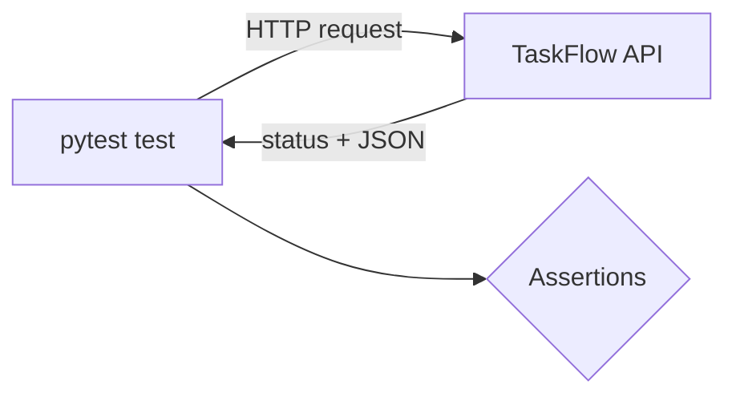

<TLDR>
API testing sends HTTP requests straight to an endpoint and checks the status code and response body. It runs faster than UI testing and is more stable. Most TaskFlow business rules are best tested here.
</TLDR>

## What and why

An API (application programming interface) is the set of endpoints a client calls. For TaskFlow, that is `POST /api/tasks`, `PUT /api/tasks/{id}` and the rest listed in [the TaskFlow reference](/start-here/taskflow-reference).

An API test sends a request, then checks the response. It skips the browser, so it runs in milliseconds and fails for reasons that matter: a wrong status code, a missing field, or a rule that is not enforced.

## How it works

Each API test follows the same steps:

1. Arrange: log in and create any data needed.
2. Act: send one request.
3. Assert: check the status code, then the body, then any side effect (for example, a follow-up `GET`).



## When to use it (and when not to)

| Use it when | Skip it when |
|---|---|
| Checking a business rule (title length, status flow, membership) | You need to see layout or colours |
| Checking auth (401 without token, 403 for non-members) | The behaviour only exists in the browser |
| Checking error codes such as 409 and 422 | You are measuring speed under load (see [Locust with pytest](/load-testing-tools/locust-with-pytest)) |

## TaskFlow example

The runnable tests are in `examples/taskflow/tests/test_taskflow_api.py` (19 tests). They use FastAPI's `TestClient`, which is built on httpx. The sketch below uses httpx directly against a running local server, `uvicorn app.main:app`. It was **not run** here. Compare it with the checked-in file.

httpx 0.28.1 is pinned in `requirements-dev.txt`. Its `Client` supports `base_url`, a default `timeout`, and JSON bodies (from the httpx quickstart, checked 2026-11-06).

```python
import httpx

BASE_URL = "http://localhost:8000"

def test_created_task_can_be_read_back():
    with httpx.Client(base_url=BASE_URL, timeout=5.0) as client:
        login = client.post("/api/auth/login",
                            json={"username": "alice", "password": "alice-pass"})
        assert login.status_code == 200
        headers = {"Authorization": f"Bearer {login.json()['token']}"}

        created = client.post("/api/tasks", headers=headers,
                              json={"title": "Write tests", "priority": "MEDIUM", "project_id": 1})
        assert created.status_code == 201
        task_id = created.json()["id"]

        fetched = client.get(f"/api/tasks/{task_id}", headers=headers)
        assert fetched.status_code == 200
        assert fetched.json()["title"] == "Write tests"
```

Set a timeout. Without one, a hung server can stall the whole run.

## Do this

- Check the status code first, then the body. A 500 with a wrong body should fail with a clear message.
- Test each rule at its boundary. Title length 0, 1, 100 and 101 are in the example file.
- Test auth: no token, a wrong password, and a non-member.
- Make each test create its own data, so tests do not depend on order.
- Recommendation: use `httpx.Client` as a context manager, so connections close.

## Avoid this

- Asserting only `status_code == 200`. A wrong body with the right code still passes.
- Sharing one task between many tests. A change in one test then breaks the others.
- Sending real passwords in test code. Read them from environment variables in a real project.

## Further reading

- [HTTPX quickstart](https://www.python-httpx.org/quickstart/)
