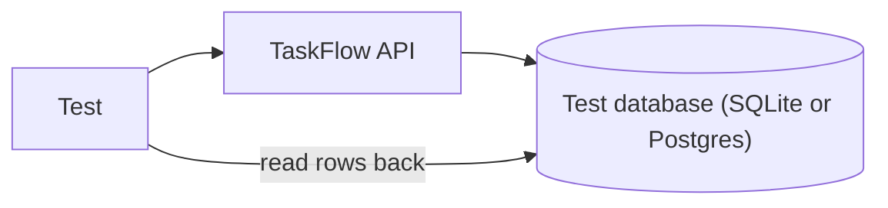

<TLDR>
Backend and database testing checks the logic behind the API and what is saved in the database. A response can look right while the stored data is wrong. Test against a clean database, and check the stored rows as well as the response.
</TLDR>

## What and why

The backend is the code that runs behind the API: validation, rules and calls to the database. The database is where the results live.

A response can hide a problem. `POST /api/tasks` may return `201` and a task body, while the row saved is missing a field or points at the wrong project. Backend tests look at both the response and the stored data.

## How it works

The database layer uses SQLAlchemy. TaskFlow defines tables such as `users`, `projects`, `project_members` and `tasks` in `app/main.py`. The test fixture in `tests/test_taskflow_api.py` drops and recreates the tables before each test, so every test starts with the same seed data.



## When to use it (and when not to)

| Use it when | Skip it when |
|---|---|
| A rule writes to more than one table | The check is only about the response shape |
| You need to confirm a delete really removed a row | The database is shared with other teams' data |
| You change a migration or a column type | You are testing the production database |

## TaskFlow example

After a `PUT` that changes status, the stored row should match. The sketch below reads the `tasks` table with SQLAlchemy, using the `engine` that `app.main` exposes. It was **not run** here, and it assumes the server uses the same database as the test.

```python
import httpx
from sqlalchemy import text
from app.main import engine

def test_status_change_is_saved():
    with httpx.Client(base_url="http://localhost:8000", timeout=5.0) as client:
        token = client.post("/api/auth/login",
                            json={"username": "alice", "password": "alice-pass"}).json()["token"]
        headers = {"Authorization": f"Bearer {token}"}
        task_id = client.post("/api/tasks", headers=headers,
                              json={"title": "Check DB", "priority": "LOW", "project_id": 1}).json()["id"]

        r = client.put(f"/api/tasks/{task_id}", headers=headers, json={"status": "IN_PROGRESS"})
        assert r.status_code == 200

    with engine.connect() as conn:
        row = conn.execute(text("SELECT status FROM tasks WHERE id = :id"), {"id": task_id}).one()
    assert row.status == "IN_PROGRESS"
```

Keep direct database reads rare. They tie the test to the table design. Prefer a `GET` when the API already returns the value.

## Do this

- Start every test from a known state. Drop, create and seed, as the TaskFlow fixture does.
- Check the stored data after writes that matter, such as status changes and deletes.
- Run the same tests on SQLite and Postgres when the app supports both. Differences in types and constraints show up this way.
- Recommendation: keep one place for database setup, so every test uses the same helper.

## Avoid this

- Testing against a shared staging database. Other people's data changes your results.
- Checking only the HTTP response when a background job or second table is also changed.
- Writing SQL in many tests. When the schema changes, every test breaks.
