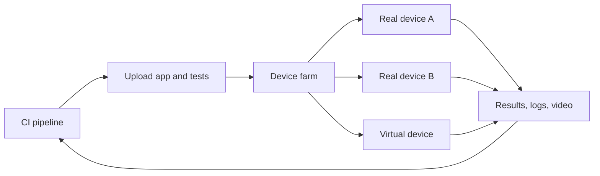

<TLDR>
An emulator or simulator is software that pretends to be a phone. A real device is the actual hardware. Use emulators for fast daily feedback and real devices for the checks where hardware matters. A device farm rents you real devices over the network, so you do not buy and look after a phone shelf yourself.
</TLDR>

## What and why

Users run your app on thousands of phone models. Each has its own chip, screen, battery, camera, OS version and manufacturer changes. You cannot own them all. This page covers the two ways to stand in for them.

- **Emulator (Android) or simulator (iOS):** software on your computer that behaves like a phone. Fast to start, free to run, easy to reset.
- **Real device:** the physical phone or tablet.
- **Device farm:** a service that hosts many real devices (and often virtual ones) in data centres. You upload your app and tests, or connect to a device remotely.

Things that depend on hardware or the vendor's software are where emulators are weakest: camera, biometrics, Bluetooth, push notifications, sensors, battery and thermal behaviour, real network conditions, and manufacturer-specific OS changes. Performance numbers from an emulator also do not describe a real phone. For app-level mobile testing basics, see [Mobile app testing](/testing-by-layer/mobile-app-testing). For which devices to pick, see [Compatibility testing](/other-non-functional/compatibility-testing).

## How it works

Most farms follow the same loop: upload the built app, choose devices, run the tests in parallel, and read the report with logs, screenshots and video.

### The main services

Facts below were checked on the vendors' own pages as of 2026-11-06. Descriptions of what a vendor offers are **vendor marketing or vendor documentation**, not independent measurements. Features and plans change, so recheck before you buy.

| Service | What it is | How it runs tests | How it charges (general terms) |
|---|---|---|---|
| BrowserStack App Automate | A real-device cloud for automated mobile tests. The vendor says it offers real iOS and Android devices | Connect an existing suite (Appium, Espresso, XCUITest and Maestro are named). Runs in the vendor's cloud, with parallel runs and CI integrations | Automation plans are sized by how many tests run in parallel. Live manual testing is sold by number of users. Monthly or annual billing. A free trial is offered |
| Sauce Labs | Real devices in vendor data centres, plus Android emulators and iOS simulators | Upload the app, then run Appium tests from your own tooling or Espresso and XCUITest tests with the `saucectl` CLI | Subscription plans. Parallelism (concurrent sessions) depends on the plan. A free trial is offered |
| Firebase Test Lab | Google's service. Physical and virtual Android devices, and physical iOS devices | Android: instrumentation tests or Robo, an automatic explorer. iOS: XCTest. Start from the console, the `gcloud` CLI, Android Studio or CI. You define a matrix of devices, OS versions and locales | By testing time. A no-cost tier exists on the free plan. Physical devices cost more than virtual ones |
| AWS Device Farm | AWS service for Android, iOS and web apps on real, physical phones and tablets. Available only in one region, `us-west-2`, at the time of checking | Two modes: remote access (use a device in the browser, or run Appium from your machine), and managed automated runs where you upload app and tests | Pay per device minute, or monthly "unmetered" device slots, or private devices on a monthly subscription. A one-time free trial exists |

Firebase Test Lab says it is not meant for load-testing your back end. Recommendation: treat any device farm the same way. It tests the app on a device, not your servers. For server load, use the tools in [Choosing a load testing tool](/load-testing-tools/choosing-a-tool).

## When to use it (and when not to)

**Recommendation:** use emulators for the fast loop and a small, chosen set of real devices before release. This is a common practice, not a standard.

| Situation | Emulator or simulator | Real device |
|---|---|---|
| Unit and component tests, pull-request checks | Yes. Fast and cheap | Not needed |
| UI flows with no hardware features | Yes, for most runs | A small smoke set on one or two models |
| Camera, biometrics, Bluetooth, NFC, sensors | No. Often unavailable or faked | Yes |
| Push notifications and deep links | Partly, with caveats | Yes, before release |
| Manufacturer OS skins and gesture navigation | No | Yes |
| Startup time, scroll smoothness, battery, memory | No. Numbers do not transfer | Yes |
| Release candidate sign-off | No | Yes. Pick devices from your own usage data |
| Reproducing a bug that only one user model has | No | Yes. Remote access to that model |
| Limited budget or no external access allowed (private data) | Yes | Consider your own small lab, or private devices from a farm |

## TaskFlow example

TaskFlow has an Android and an iOS app that call the same API as the web app. A sensible split:

1. Every pull request: run UI tests on an emulator and a simulator against a test backend.
2. Nightly: run the same suite on a farm across a short device list, chosen from the app's analytics, for example the top few models and the oldest supported OS.
3. Release candidate: run the smoke flow (log in, create a task, assign it, change its status) on real devices, plus a push-notification check for `task.assigned`.

The farm does not need to reach a developer's laptop. It needs a test environment it can call. See [Test environments](/modern-quality-engineering/test-environments). If your backend is private, check how each vendor connects to private networks before you choose.

## Do this

- Choose devices from your own usage data, not from a vendor's longest list.
- Keep the number of real-device tests small and stable. They are slower and cost more.
- Record the device model and OS in every test report.
- Check the free trial with your own app before you commit.
- Check data rules first. Do not upload real user data to a shared cloud.

## Avoid this

- Treating a pass on an emulator as a pass on real phones.
- Running the whole suite on every device on every commit.
- Buying parallel capacity before you know how long your suite takes.
- Using a device farm to judge back-end capacity.

## Further reading

- [BrowserStack App Automate](https://www.browserstack.com/app-automate) (vendor page, checked 2026-11-06)
- [Sauce Labs: automated mobile app testing](https://docs.saucelabs.com/mobile-apps/automated-testing/) (vendor docs, checked 2026-11-06)
- [Firebase Test Lab](https://firebase.google.com/docs/test-lab) (official docs, checked 2026-11-06)

AWS facts come from the AWS Device Farm Developer Guide ("What is AWS Device Farm?") and the AWS Device Farm pricing page, both read on 2026-11-06.
