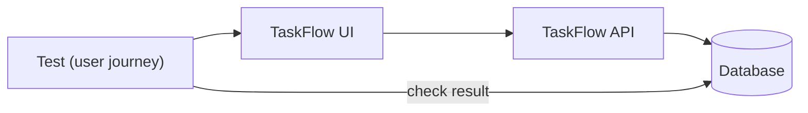

<TLDR>
An end-to-end (E2E) test follows one user journey from the screen to the database and back. It proves the pieces work together for that journey. Because these tests are slow and can be flaky, keep only a handful for the most important journeys.
</TLDR>

## What and why

An E2E test is a glossary term: it drives the whole system the way a user would. For TaskFlow, a journey could be: log in, create a project, create a task, assign it to Bob, and move it to `IN_PROGRESS`.

E2E tests catch problems that smaller tests cannot. A UI may send the wrong field, an API may reject a valid request, or a database constraint may fail. Lower-level tests do not show these links.

## How it works

An E2E test uses the same tools as the layers below it: a browser driver for the screen, HTTP calls for setup, and database checks where needed. What makes it "end to end" is that nothing is mocked along the journey.



## When to use it (and when not to)

| Use it when | Skip it when |
|---|---|
| The journey crosses several parts, such as UI, API and database | A single rule can be checked at the API |
| A release would hurt if this journey broke | The journey is a minor variant of one already tested |
| You need a smoke check after a deploy | You want to test many inputs (use [test design techniques](/test-design/equivalence-partitioning-and-boundaries)) |

## TaskFlow example

One journey that covers the main path: log in, create a task, assign it to Bob (user id 2, a member of project 1), and check the status flow. Setup can use the API for speed, and the final check can use the UI, so each test covers a different layer.

```python
def test_journey_create_assign_and_progress(client, login, new_task):
    headers = login(client)                                   # alice logs in
    task = new_task(client, headers, title="Ship release").json()

    r = client.post(f"/api/tasks/{task['id']}/assign",
                    headers=headers, json={"user_id": 2})     # bob is a member
    assert r.status_code == 200
    assert r.json()["assignee_id"] == 2

    r = client.put(f"/api/tasks/{task['id']}",
                   headers=headers, json={"status": "IN_PROGRESS"})
    assert r.status_code == 200
    assert r.json()["status"] == "IN_PROGRESS"
```

The `client`, `login` and `new_task` names follow the helpers in `examples/taskflow/tests/test_taskflow_api.py`. Adapt them to your fixtures. This sketch was **not run**. A true UI journey would use Playwright instead (see [UI testing](/testing-by-layer/ui-testing)).

## Do this

- Pick journeys by business value: sign-up, the core task flow, and payments in a real product.
- Keep each journey short. Five to ten steps is a good limit.
- Set up data through the API, and check results through the UI or API.
- Recommendation: run a small E2E smoke suite after each deploy, and run the larger suite less often.

## Avoid this

- Turning every test into an E2E test. They are the slowest layer and the most fragile.
- Starting each journey from the login screen when setup through the API is faster.
- Sharing data between journeys. Each journey should create what it uses.
