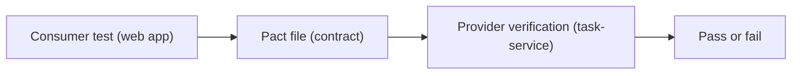

<TLDR>
Integration testing checks that parts of the system work together. Contract testing checks a narrower thing: that a caller (the consumer) and a service (the provider) agree on the shape of their messages. Pact is a tool where the consumer writes the contract, and the provider has to prove it meets it.
</TLDR>

## What and why

When TaskFlow's web app calls `task-service`, both sides must agree on the request and the response. If the service renames `assignee_id`, the web app breaks. Nobody notices until a full system test runs, and that is late and slow.

An integration test runs the real services together. It is useful but needs every service, a database and often test data. A contract test is smaller. It records the calls one side makes and checks that the other side can answer them.

## How it works

Pact is a contract testing tool. In plain English:

- The **consumer** writes a test that says, "When I call `GET /api/tasks/1`, I expect a 200 with a `title` field." Pact runs that test against a mock and writes the expectation to a file, called a **pact**.
- The **provider** runs its own tests against that file. For each expectation, Pact replays the request on the real provider and checks the response.

The consumer decides what it needs. So the provider can change anything no consumer uses. This is why Pact is called **consumer-driven**. The Pact docs describe it as checking only the parts of a service that real consumers use.



## When to use it (and when not to)

| Use it when | Skip it when |
|---|---|
| Two teams deploy services separately | One team owns both sides and they ship together |
| A change in one service has broken another before | The interface is a public, documented API you do not control (use schema tests) |
| You want fast feedback without running every service | You need to check real data flow end to end (see [end-to-end testing](/testing-by-layer/end-to-end-testing)) |

## TaskFlow example

The web app is the consumer. It calls `GET /api/tasks/{id}` on `task-service`. The sketch below uses pact-python. Its docs (main branch, checked 2026-11-06) show a V4 specification with `upon_receiving`, `given`, `with_request` and `will_respond_with`. A real consumer test for `POST /api/auth/login` and `GET /api/tasks/{id}` is in `examples/taskflow/contract/test_web_consumer_pact.py`. With pact-python 4.2.0 (pact-python-ffi 0.5.12.1) it ran: **2 passed in 2.08s**. We ran only the consumer side. The provider verification was **not run**. The shorter sketch below shows the pattern.

```python
from pathlib import Path
import pytest
from pact import Pact, match

@pytest.fixture
def pact():
    p = Pact("taskflow-web", "task-service").with_specification("V4")
    yield p
    p.write_file(Path(__file__).parent / "pacts")

def test_web_app_can_read_a_task(pact):
    body = {"id": match.int(1), "title": match.str("Write tests")}
    (pact.upon_receiving("a request for task 1")
         .given("task 1 exists")
         .with_request("GET", "/api/tasks/1")
         .will_respond_with(200)
         .with_body(body, content_type="application/json"))
    with pact.serve() as srv:
        # Call the real web-app client here, pointed at srv.url.
        pass
```

The `match` helpers check the **type** of each value, not an exact value. That keeps the contract useful when data changes.

## Do this

- Write contracts only for fields a consumer actually reads.
- Use type matchers, not fixed values, for ids and timestamps.
- Publish contracts to a shared broker, or keep them in version control, so providers can verify them in their own pipeline.
- Recommendation: run provider verification in the provider's CI, and block a deploy when verification fails.
- Keep a small number of end-to-end tests to prove the whole flow still works.

## Avoid this

- Using contracts to test business rules. Rules belong in API tests (see [API testing](/testing-by-layer/api-testing)).
- Writing contracts for every field the provider returns. Unused fields make changes harder.
- Treating a passing contract as proof that the whole system works.

## Further reading

- [Pact: introduction and getting started](https://docs.pact.io/)
- [pact-python on GitHub](https://github.com/pact-foundation/pact-python)
