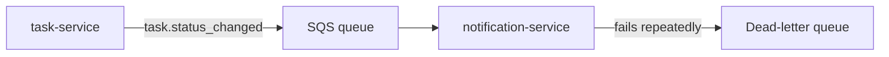

<TLDR>
In an event-driven system, services send messages instead of calling each other directly. Messages can arrive twice, late or out of order. Test that the consumer handles these cases safely. For TaskFlow, `notification-service` must not send two emails for one `task.assigned` event.
</TLDR>

## What and why

TaskFlow's `task-service` publishes `task.assigned` and `task.status_changed` events through SNS and SQS. `notification-service` reads them and sends notifications. Nothing waits for a reply, so a slow or failed consumer does not block the task API.

The trade-off is that the message path is harder to test. Standard SQS queues give **at-least-once delivery**. The AWS docs say more than one copy of a message might be delivered, and messages may occasionally arrive out of order (checked 2026-11-06).

:::info[Conceptual examples]
The examples below are conceptual. The local TaskFlow has no queue, so nothing here runs locally. Test the logic with a fake in-memory queue, or with a queue you run yourself.
:::

## How it works

Three properties decide whether a consumer is safe:

| Property | What goes wrong | What the consumer must do |
|---|---|---|
| **Idempotency** | The same event arrives twice and the email is sent twice | Record the event ID and skip repeats |
| **Ordering** | `DONE` arrives before `IN_PROGRESS` | Ignore events older than the last one applied, or use a version number |
| **Retries** | A temporary error drops the message | Retry with backoff, then move the message to a dead-letter queue |



## When to use it (and when not to)

| Use it when | Skip it when |
|---|---|
| A service reacts to events from another service | One process does the work in one call |
| You need the task API to stay fast while notifications run later | The user must see the result before the request returns |
| You add a new consumer to an existing event | The event is only logged, with no action taken |

## TaskFlow example

Each `task.status_changed` event should carry an `event_id` and a `version`. The consumer keeps the last version it applied for each task. The sketch below uses an in-memory store to show the idea. It is **conceptual** and **not run**.

```python
processed_ids: set[str] = set()
last_version: dict[int, int] = {}

def handle_status_changed(event: dict, send_email) -> str:
    if event["event_id"] in processed_ids:
        return "duplicate: skipped"                 # idempotency
    task_id, version = event["task_id"], event["version"]
    if version <= last_version.get(task_id, 0):
        return "stale: skipped"                     # ordering
    send_email(event)
    processed_ids.add(event["event_id"])
    last_version[task_id] = version
    return "applied"

def consume(event, send_email, attempts=3):
    for attempt in range(1, attempts + 1):          # retries
        try:
            return handle_status_changed(event, send_email)
        except ConnectionError:
            continue
    return "send to dead-letter queue"
```

Tests for this logic should cover four cases: a duplicate, an out-of-order event, a transient error that recovers, and a permanent error that goes to the dead-letter queue. In production, the processed-IDs store must be shared and durable, such as a database table.

## Do this

- Give every event a unique `event_id`, and make consumers skip repeats.
- Add a version or timestamp to `task.status_changed`, and reject stale updates.
- Retry transient errors with a short backoff, and cap the number of attempts.
- Send messages that keep failing to a dead-letter queue, and alert on it.
- Recommendation: test with duplicated and reordered events on purpose.

## Avoid this

- Assuming exactly-once delivery. Design for duplicates.
- Retrying forever. A poison message then blocks the queue.
- Testing only the happy path where events arrive once, in order.
- Using `sleep` in tests to wait for a consumer. Poll with a timeout instead.

## Further reading

- [Amazon SQS standard queues](https://docs.aws.amazon.com/AWSSimpleQueueService/latest/SQSDeveloperGuide/standard-queues.html)
