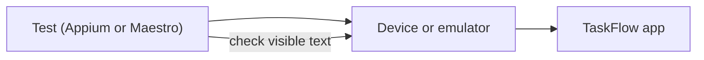

<TLDR>
Mobile testing checks the Android and iOS TaskFlow apps on screen. Appium and Maestro are tools that tap, type and read the screen. They drive the app; they do not measure speed, memory or battery. Use [mobile performance](/performance-by-layer/mobile-performance) for those.
</TLDR>

## What and why

TaskFlow has Android and iOS apps alongside the React web app. A bug may appear only on one platform, such as a keyboard that hides the Save button. Mobile UI tests catch these.

Mobile tests are harder than web tests. You need a device or emulator, the right OS version, and an app build. Tests also run more slowly, so keep them few.

## How it works

Two tools are common:

- **Appium** is an open-source framework built on the WebDriver protocol. It has drivers for each platform (for example UiAutomator2 for Android and XCUITest for iOS). Your test code calls Appium, and Appium drives the device. Its docs describe it as an ecosystem for UI automation.
- **Maestro** runs short YAML flows. Each step is a command, such as `launchApp`, `tapOn` or `assertVisible`. Its docs describe it as a YAML-based framework for mobile and web UI automation.

Both tools automate the screen. Neither measures how fast the app is, how much memory it uses, or how much battery it drains.



## When to use it (and when not to)

| Use it when | Skip it when |
|---|---|
| Checking a key flow on Android and iOS (login, create task) | Checking the rules (use the API) |
| Testing a screen layout on a real device | Measuring startup time, jank or battery (see [mobile performance](/performance-by-layer/mobile-performance)) |
| A platform-only bug needs a device to reproduce | You can test the same screen on a web view cheaply |

## TaskFlow example

A short Maestro flow for the login screen. The app ID and labels below are illustrative. Real values depend on the app build. This flow was **not run** here.

```yaml
appId: com.example.taskflow
---
- launchApp:
    clearState: true
- tapOn: "Username"
- inputText: "alice"
- tapOn: "Password"
- inputText: "alice-pass"
- tapOn: "Log in"
- assertVisible: "Create task"
```

With Appium, the same check uses an `UiAutomator2Options` object and `webdriver.Remote` to start a session. Locate elements by accessibility ID, which the Appium Python client supports through `AppiumBy.ACCESSIBILITY_ID`.

## Do this

- Keep mobile tests to the key flows: login, create a task, and the status change.
- Use accessibility IDs or test IDs in the app for locators. Text labels change with translation.
- Run mobile tests against a fixed OS version and device, and record both in the report.
- Recommendation: use Maestro for quick smoke flows and Appium when you need full code control.

## Avoid this

- Calling Appium or Maestro a performance tool. Their results show that a step worked, not how fast it was.
- Testing business rules on the device. Those belong in API tests.
- Running a large mobile suite on every commit. Keep it for nightly or pre-release runs.

## Further reading

- [Appium documentation](https://appium.io/docs/en/latest/)
- [Maestro documentation](https://docs.maestro.dev/)
