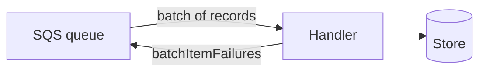

<TLDR>
Serverless code runs as functions that start when an event arrives, such as a queue message. The function is small, but the risks sit around it: the event shape, the permissions it has, and the time it takes to start. Test the handler logic with plain Python, then test the wiring in a real or emulated environment. The example in `examples/serverless/` covers the handler logic only.
</TLDR>

## What and why

A **serverless function** is code that a cloud platform runs for you when an event happens. You do not manage servers. You pay for each run. AWS Lambda is the best known example.

Serverless changes what goes wrong. The code is short, so the bugs are often in the glue: the event format, the retry rules, the permissions, and the timeouts. A unit test of the business logic will not catch a wrong event field or a missing permission.

## How it works

Four things shape a serverless test:

- **Cold starts.** When no copy of the function is ready, the platform creates one. This adds delay on the first call. Code that loads large libraries or opens connections at import time makes cold starts slower. A test can check that the handler does not do this work at import time.
- **Event sources.** A queue, an HTTP gateway or a schedule sends the event. Each source has its own shape. An SQS event carries a list of `Records`, and each record has a `messageId` and a `body` string.
- **Permissions.** The function can do only what its role allows. A missing permission often shows up as an error only in the real cloud. Check the policy as part of the test plan.
- **Local emulation.** You can run the handler with a hand-written event, or with a local emulator or an in-process mock of the cloud service. A mock can hide real behaviour, so treat a local pass as a first check, not proof.



## When to use it (and when not to)

| Use it when | Skip it when |
|---|---|
| A function reacts to queue messages or other events | The work is a long-running job better suited to a container |
| You change the event parsing or the failure handling | You only need to test a pure function, which a [unit test](/testing-by-layer/unit-testing-and-tdd) covers |
| You need to prove a permission or a trigger works | You would test against a shared production account |

## TaskFlow example

TaskFlow's production design does not use Lambda. The local app is a FastAPI server. This example is a small queue handler, in the same style, that could sit behind SQS. The handler reads each record, parses the JSON body, validates it with the same rules as the TaskFlow API (a title of 1 to 100 characters and a required priority of LOW, MEDIUM or HIGH), and stores the task in an in-memory dict named `TASKS`. It makes no AWS calls and creates no AWS client at import.

```python
def handler(event: dict, context=None) -> dict:
    failures = []
    for record in event.get("Records", []):
        try:
            task = json.loads(record["body"])
            _validate(task)
            _store(task)
        except (ValueError, KeyError, TypeError):
            failures.append({"itemIdentifier": record.get("messageId", "")})
    return {"batchItemFailures": failures}
```

The handler returns the failed message IDs in `batchItemFailures`. This is the shape that AWS documents for partial batch responses. Lambda only uses it when the event source mapping has `ReportBatchItemFailures` turned on. If the function throws an error instead, the whole batch counts as failed. See [Handling errors for an SQS event source in Lambda](https://docs.aws.amazon.com/lambda/latest/dg/services-sqs-errorhandling.html). Checked 2026-11-06.

The tests in `examples/serverless/tests/test_handler.py` cover seven cases: a valid record, a bad JSON record, an empty batch, a 101-character title, a 100-character title, a missing priority and an unknown priority. Like the TaskFlow API, the handler requires a priority. Run them from `examples/serverless/`:

```bash
pytest -q
```

Real output from one run in this repository (pytest 9.2.0, Python 3.12.8):

```
.......                                                                  [100%]
7 passed in 0.01s
```

The example uses no mock library, so nothing can reach AWS. Testing the wiring is a separate job: a deployed test in a non-production account, or a local emulator. Those are not run here.

## Do this

- Test the handler with hand-written events that match the real event shape. Copy one real event from your logs, then remove private data.
- Test the failure path. A bad record should go to the failure list, and the good records should still be stored.
- Keep the imports light. Create clients inside the handler or lazily, so the cold start stays short.
- Check the permissions with a test in a non-production account, not only by reading the policy.
- Test the timeout and retry settings the way they are deployed.

## Avoid this

- Treating a mock as the real cloud. Mocks miss permission errors and quota limits.
- Throwing an exception for one bad record. That fails the whole batch.
- Calling AWS from a unit test. Use the function's inputs and outputs instead.

## Further reading

- [Handling errors for an SQS event source in Lambda](https://docs.aws.amazon.com/lambda/latest/dg/services-sqs-errorhandling.html). Checked 2026-11-06. Explains partial batch responses.
