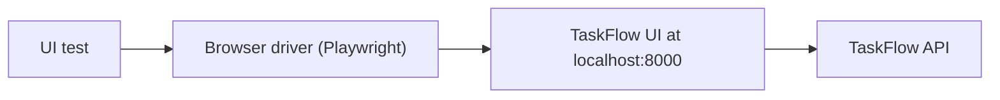

<TLDR>
UI testing checks the screen. A script opens a browser, clicks, types and reads the page, just as a user would. It is slow and can be flaky, so use it for a few key screens and flows, and test rules at the API level.
</TLDR>

## What and why

A UI test (also called a front-end or browser test) drives a real web page. It finds elements such as buttons and inputs, acts on them, and checks what appears. It answers one question: can a user do the job on screen?

UI tests catch problems that API tests miss. A button may be hidden, a form may not send the right data, or a page may show the wrong text. API tests cannot see any of that.

## How it works

A UI test has three parts:

1. **Driver.** A tool that controls the browser. This handbook uses Playwright.
2. **Locators.** Ways to find an element. Prefer roles, labels and test IDs (`data-testid`) over CSS paths that break when layout changes.
3. **Assertions.** Checks that wait until the page shows the expected state.



## When to use it (and when not to)

| Use it when | Skip it when |
|---|---|
| A user journey needs the screen (login, create a task) | You only want to check a rule, such as title length |
| You need to check layout, text or visibility | The UI is a thin shell over an API you already test |
| A bug was only visible on screen | You need hundreds of input combinations |

## TaskFlow example

The TaskFlow UI (see [the TaskFlow reference](/start-here/taskflow-reference)) has `data-testid` attributes on every control. The example below logs in, creates a task and checks that it appears in the list.

Playwright's Python docs (checked 2026-11-06) show `pytest-playwright` providing a `page` fixture. The real, runnable tests are in `examples/taskflow/ui-tests/test_taskflow_ui.py`. They cover login, create, title lengths of 1, 100 and 101 characters (the 101 case shows a 422 error in the log area) and the task list. With pytest-playwright 0.10.0, Playwright 1.64.1 and Chromium against a local server, **6 passed in 3.34s**. Start the server, then run `pytest ui-tests --base-url http://localhost:8000`. The short version below shows the core idea and was not run on its own.

```python
from playwright.sync_api import Page, expect

def test_created_task_appears_in_list(page: Page):
    page.goto("http://localhost:8000")
    page.get_by_test_id("login").click()
    expect(page.get_by_test_id("who")).to_have_text("Logged in")

    page.get_by_test_id("task-title").fill("Buy milk")
    page.get_by_test_id("create-task").click()
    page.get_by_test_id("list-tasks").click()

    expect(page.get_by_test_id("task-item").first).to_contain_text("Buy milk")
```

Note the assertion style. `expect(...)` waits and retries until the text appears or a timeout passes. A plain `assert` on `text_content()` does not wait, and that causes flaky tests.

## Do this

- Keep UI tests to key journeys: login, create, assign, and the status flow.
- Use role, label and `data-testid` locators. Avoid long CSS or XPath chains.
- Use Playwright's auto-waiting `expect` assertions instead of fixed sleeps.
- Test business rules through the API (see [API testing](/testing-by-layer/api-testing)), and keep one UI check per rule at most.
- Recommendation: keep the UI suite small enough to run on every pull request.

## Avoid this

- Writing one UI test per validation rule. Title length belongs in API or unit tests.
- Using `time.sleep()` to wait for the page. It is slow and still flaky.
- Sharing one logged-in browser session across tests that change data. Each test should start clean.

## Further reading

- [Playwright for Python: installation](https://playwright.dev/python/docs/intro)
