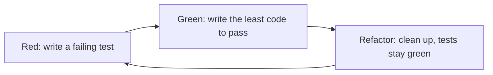

<TLDR>
A unit test checks one small piece of code with no network, database or server. It is the fastest feedback you get. Test-driven development (TDD) means writing the failing test first, then the code. This page uses real unit tests for TaskFlow's rules.
</TLDR>

## What and why

A unit is the smallest piece you can test alone, usually a function or a class. Unit tests run in milliseconds and point at the exact line that broke. The place of unit tests in the pyramid is covered in Test levels and test types and Test automation pyramid.

## How it differs from the API tests

The API tests in the repo (see API testing) send HTTP requests through the whole app, including the database. The unit tests below import the rule constants and validators and call them directly.

| | API test | Unit test |
|---|---|---|
| Needs a running app and database | Yes (TestClient plus SQLite) | No |
| Checks | Status codes, auth, whole flows | One rule or function |
| Failure tells you | Something in the request path broke | Which rule broke |
| Good for | Wiring between parts | Many input combinations, cheaply |

Both are needed. Unit tests do not prove the endpoint returns 409. They prove the table behind it is right.

## Red, green, refactor



1. **Red.** Write a test for behaviour that does not exist yet. Run it. It must fail, or it proves nothing.
2. **Green.** Write the simplest code that passes.
3. **Refactor.** Improve the code while the tests stay green.

TDD is a design habit, not a requirement. Recommendation: use it for rule-heavy logic like status transitions, and do not force it on UI glue code.

## TaskFlow example

The file `examples/taskflow/unit/test_status_rules.py` imports `TRANSITIONS`, `PRIORITIES`, `TaskCreate` and `TaskUpdate` from `app.main`. It does not edit app code.

```python
from app.main import TRANSITIONS

@pytest.mark.parametrize("start, end", [
    ("TODO", "DONE"), ("TODO", "IN_REVIEW"), ("DONE", "TODO"), ("REOPENED", "DONE"),
])
def test_forbidden_moves(start, end):
    assert end not in TRANSITIONS[start]

@pytest.mark.parametrize("length, ok", [(0, False), (1, True), (100, True), (101, False)])
def test_title_length_rule(length, ok): ...  # TaskCreate raises ValidationError when not ok
```

Real result, run on 2026-11-06 with pytest 8.3.4 from `examples/taskflow`:

```text
$ pytest unit -q
......................                                                   [100%]
22 passed in 2.97s
```

To practise the loop: write a new failing test for an extra rule you invent, watch it go red, then change your own copy of the code. Do not edit the TaskFlow app for this.

## Do this

- Keep unit tests free of network, files and clocks.
- Use `pytest.mark.parametrize` for rule tables.
- Test behaviour through the public interface, not private details.
- Run unit tests on every save or commit.

## Avoid this

- Calling a test a unit test when it starts a server.
- Writing the test after the code and never seeing it fail.
- Mocking so much that the test only checks the mocks.
