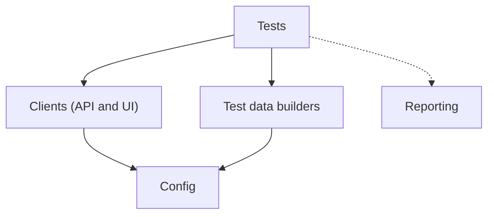

<TLDR>
An automation framework is the structure around your tests: folders, shared clients, config and reports. Good design keeps the tests short and readable, and keeps the code that talks to the system in one place. Start small and add structure only when a second test needs it.
</TLDR>

## What and why

Without structure, every test repeats its own login, its own URL and its own report setup. When TaskFlow changes a URL, you fix it in twenty places. A framework puts shared code in one place.

A framework is not a goal. It is a means to keep tests trustworthy as the suite grows. A large framework that nobody understands is a liability.

## How it works

Split the project into layers. Each layer has one job:

| Layer | Job | TaskFlow example |
|---|---|---|
| Config | Base URL, users, timeouts from environment | `TASKFLOW_URL`, test users |
| Clients | Talk to the system | An httpx client that logs in |
| Data | Create and clean test data | Build a task with defaults |
| Tests | Describe behaviour | "A non-member cannot create a task" |
| Reporting | Record results | JUnit XML and Allure results |



The rule is one-way. Tests can use clients. Clients must not know about tests.

## When to use it (and when not to)

| Use it when | Skip it when |
|---|---|
| Three or more tests repeat the same setup | You have five tests and a single file works |
| More than one person edits the suite | You are writing a throwaway script |
| You run the suite in several environments | The suite only runs on one laptop, once |

## TaskFlow example

The existing `examples/taskflow/` project is a simple structure: a `tests/` folder and a `conftest.py` that sets the database path before the app loads. A small next step is a client module that wraps login:

```python
# clients/taskflow_api.py
import os
import httpx

BASE_URL = os.environ.get("TASKFLOW_URL", "http://localhost:8000")

def login(username: str, password: str) -> dict:
    with httpx.Client(base_url=BASE_URL, timeout=5.0) as c:
        r = c.post("/api/auth/login", json={"username": username, "password": password})
        r.raise_for_status()
        return {"Authorization": f"Bearer {r.json()['token']}"}
```

Tests then call `login("alice", "alice-pass")` and do not repeat the URL or the token logic. Passwords here are demo values. In a real project, read them from environment variables or a secrets store.

## Do this

- Keep config in one place and read it from environment variables.
- Keep clients thin: one function per endpoint or screen action.
- Use a `conftest.py` for shared fixtures, and keep it short.
- Recommendation: review the framework in pull requests like production code.
- Recommendation: add a layer only when the same code appears in three places.

## Avoid this

- Building a framework before writing any tests.
- Hiding assertions inside helper functions. A test should show what it checks.
- Putting business logic in the framework. Rules belong in the tests, with the expected values written out.
