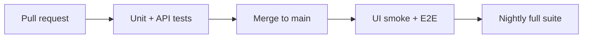

<TLDR>
Continuous integration (CI) runs your tests every time code changes. Continuous delivery (CD) moves the tested code toward release. Continuous testing places the right tests at each stage: fast checks on every change, and slower checks before and after release.
</TLDR>

## What and why

If tests run only on a laptop, they run when someone remembers. A pipeline runs them every time, on a clean machine, with the same steps. That makes results repeatable and shared.

Continuous testing means tests are part of every stage, not one big test phase at the end. Each stage has a time budget. Slow tests belong later in the pipeline, where they do not block every change.

## How it works

A typical split for TaskFlow:

| Stage | Trigger | Tests | Blocks merge? |
|---|---|---|---|
| Pull request | Every push | Unit and API tests (fast) | Yes |
| Main branch | Merge | API tests plus a small UI smoke test | Yes |
| After deploy | Deploy to test environment | E2E smoke tests | Recommendation: yes |
| Nightly | Schedule | Full UI and contract suite | No, but alert on failure |



## When to use it (and when not to)

| Use it when | Skip it when |
|---|---|
| More than one person changes the code | A one-off experiment |
| You want a gate before merge | The pipeline takes longer than the change itself |
| Releases are frequent | You have no tests yet; start with a basic pull request check first |

## TaskFlow example

A GitHub Actions workflow that runs the API tests on each pull request. It is a sketch and was **not run** in this handbook. Pin action versions to tags you have checked.

```yaml
name: taskflow-api-tests
on: [pull_request]

jobs:
  api-tests:
    runs-on: ubuntu-latest
    steps:
      - uses: actions/checkout@v4
      - uses: actions/setup-python@v5
        with:
          python-version: "3.12"
      - run: pip install -r examples/taskflow/requirements-dev.txt
      - run: pytest -q --junitxml=report.xml
        working-directory: examples/taskflow
      - uses: actions/upload-artifact@v4
        if: always()
        with:
          name: junit-report
          path: examples/taskflow/report.xml
```

`if: always()` uploads the report even when tests fail. That is the part people forget, and it is the part you need most.

GitHub's docs describe Actions as a way to automate build, test and deploy steps in a repository. See [GitHub Actions documentation](https://docs.github.com/en/actions).

## Do this

- Run the fastest tests first, and fail the pipeline early when they break.
- Upload reports on every run, including failures (see [Reporting and logging](/automation-engineering/reporting-and-logging)).
- Keep secrets in the CI secret store, never in the workflow file.
- Recommendation: make the pull request check required before merge.
- Recommendation: keep the pipeline under about 10 minutes for the pull request stage.

## Avoid this

- Running every test on every commit. Slow suites teach people to skip the pipeline.
- Ignoring a nightly failure because it does not block merges. Assign an owner.
- Copying a workflow from another project without checking the paths and secrets.
