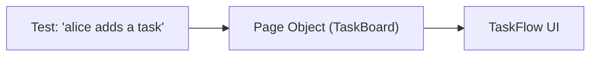

<TLDR>
Design patterns are proven ways to organise test code. The Page Object pattern hides screen details behind a class. Builders make test data easy to create with defaults. Screenplay is an alternative that models users and their tasks. Pick the simplest pattern that keeps your tests readable.
</TLDR>

## What and why

Test code changes often. A button moves, a field is renamed, a rule gets a new value. If the locators and data setup are spread across many tests, each change means many edits.

Patterns move that detail into one place. The tests then describe what the user does, not how the page is wired.

## How it works

Three patterns cover most needs:

- **Page Object.** A class that wraps one screen. It exposes actions (`add_task`) and reads (`task_titles`). Martin Fowler describes a page object as wrapping an HTML page with an application-specific API.
- **Builder.** A function or class that creates test data with sensible defaults. The test overrides only what matters.
- **Screenplay.** Each actor (user) has tasks (abilities) and asks questions about the system. It suits large suites with many user roles, and it adds more code than Page Object.



## When to use it (and when not to)

| Use it when | Skip it when |
|---|---|
| The same screen is used in ten or more tests | You have two UI tests |
| Test data has many fields and you vary only one | The data is a single value |
| Several roles need different steps | There is one user role |

## TaskFlow example

A minimal Page Object for the TaskFlow UI. It uses the `data-testid` values in `examples/taskflow/static/index.html`. This is a sketch and was **not run**.

```python
from playwright.sync_api import Page, expect

class TaskBoard:
    def __init__(self, page: Page):
        self.page = page

    def open(self):
        self.page.goto("http://localhost:8000")

    def log_in(self):
        self.page.get_by_test_id("login").click()
        expect(self.page.get_by_test_id("who")).to_have_text("Logged in")

    def add_task(self, title: str):
        self.page.get_by_test_id("task-title").fill(title)
        self.page.get_by_test_id("create-task").click()

    def refresh(self):
        self.page.get_by_test_id("list-tasks").click()

    def first_task_text(self) -> str:
        return self.page.get_by_test_id("task-item").first.inner_text()
```

A builder for task data, with defaults that match the business rules:

```python
def task_data(**overrides) -> dict:
    data = {"title": "Write tests", "priority": "MEDIUM", "project_id": 1}
    data.update(overrides)
    return data

# A test for the 101-character rule overrides only the title.
payload = task_data(title="a" * 101)
```

## Do this

- Use Page Object for UI screens, and keep assertions in tests, not in the page class.
- Use builders with valid defaults, so each test states only what it changes.
- Recommendation: start with functions and small classes. Move to Screenplay only when roles multiply.
- Name page methods after user actions, such as `add_task`, not after clicks.

## Avoid this

- Putting every assertion in the page object. Tests then read as "it passed" with no detail.
- Building deep inheritance trees of page classes.
- Using a pattern that nobody on the team can explain. Readability is the goal.

## Further reading

- [Page Object, Martin Fowler](https://martinfowler.com/bliki/PageObject.html)
