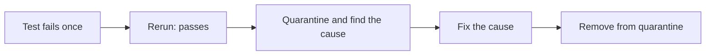

<TLDR>
A flaky test sometimes passes and sometimes fails with no code change. Flaky tests waste time and teach people to ignore red builds. Find the cause from the logs, fix it, and do not just add retries.
</TLDR>

## What and why

The glossary defines a flaky test as one that sometimes passes and sometimes fails without a code change. The cost is trust. When a suite is often red for no reason, people stop reading failures, and real bugs slip through.

Most flaky tests come from a short list of causes. Knowing the list helps you find the one that applies.

## How it works

| Cause | Typical sign | Fix |
|---|---|---|
| Timing (fixed `sleep`, page not ready) | Fails on slow CI runs | Wait for a condition with a timeout |
| Shared data (another test changed it) | Fails only when run with others | Isolate data per test |
| Order dependence | Fails when run alone or in a new order | Remove hidden state |
| Environment (time, timezone, ports) | Fails on one machine or day | Control the environment in config |
| Async events (queues, background jobs) | Fails now and then under load | Poll with a timeout; test idempotency |
| Unreliable external service | Fails when the service is slow | Use a fake for that dependency |



## When to use it (and when not to)

Use this chapter when a test fails and then passes on rerun, or when a suite is unreliable. Do not use retries as the first step. A retry hides the cause.

| Use a retry when | Do not use a retry when |
|---|---|
| The failure comes from a known, external blip, and you log every retry | You have not looked at the failure |
| You are buying time while a fix is in progress, with a due date | The retry fixes a race you should remove |

## TaskFlow example

The most common flake in UI tests is reading the page before it updates. The fix is to wait for the expected state, not to sleep.

```python
# Flaky: reads the list before the request finishes.
page.get_by_test_id("list-tasks").click()
assert "Buy milk" in page.get_by_test_id("task-list").inner_text()

# Stable: Playwright's expect waits and retries until the text appears.
page.get_by_test_id("list-tasks").click()
expect(page.get_by_test_id("task-item").first).to_contain_text("Buy milk")
```

Playwright's `expect` retries until its timeout. The first version can pass or fail depending on how fast the server answers.

## Do this

- Log the failure, the seed, the environment and a screenshot or trace when a test fails.
- Track flaky tests in a list with an owner and a date. Quarantine them while they are fixed.
- Remove fixed sleeps. Use explicit waits with timeouts.
- Run a suspect test 20 times in a row before and after a fix. Record the result.
- Recommendation: set a limit for how long a test can stay quarantined, such as two sprints.

## Avoid this

- Adding `retries=5` to hide the problem.
- Deleting a flaky test without saying why.
- Blaming CI. Most flakes reproduce locally with the same data and order.
