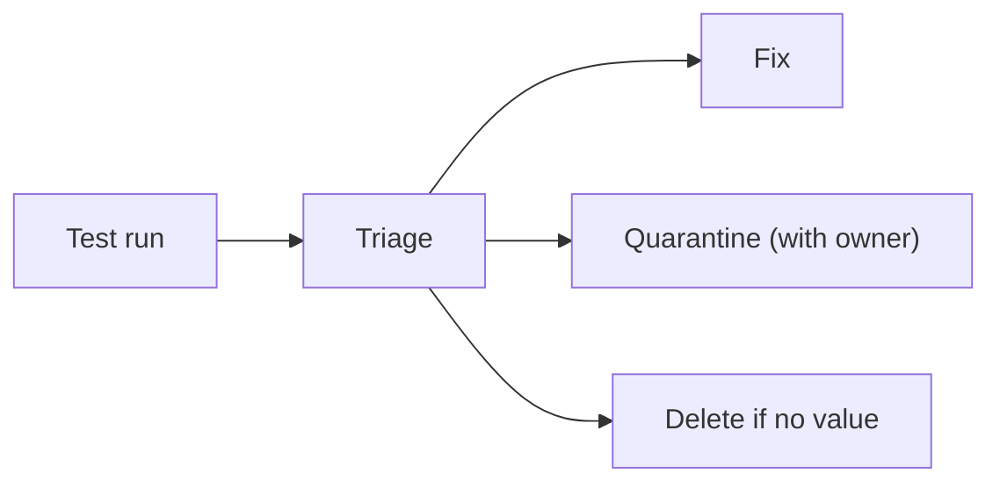

<TLDR>
An automation suite gets worse unless someone looks after it. Tests break when the product changes, runs slow down, and nobody remembers what some tests check. Give the suite owners, review changes to it, and remove tests that no longer help.
</TLDR>

## What and why

Automation is code, and code needs upkeep. The suite grows with every feature. Some tests stop matching the product. Others duplicate each other or fail on every run. Over time, the team stops trusting the results.

Maintenance is the routine work that keeps the suite useful: fixing, removing, renaming and reviewing tests.

## How it works

A simple routine:

| Activity | How often | Output |
|---|---|---|
| Triage failures | Every run | Fix, quarantine, or log a defect |
| Review flaky list | Weekly | Each item has an owner and a date |
| Review slow tests | Monthly | Speed-up or move to a lower layer |
| Review coverage of key flows | Each release | Gaps added or noted |
| Delete dead tests | Each quarter | Smaller, clearer suite |



## When to use it (and when not to)

| Use it when | Skip it when |
|---|---|
| The suite is older than a few months | You are still building the first version (focus on design first) |
| Failures are often ignored | The suite is small and everyone knows it well |
| People leave and new people join | The product is about to be retired |

## TaskFlow example

A rule for the TaskFlow suite: a test that breaks because a URL changed should be fixed in one place, not in every test. If the status flow changes (for example, a new `BLOCKED` status), update the rule in one module and the tests that use it.

```python
# Before: the URL is repeated in every test.
r = client.post("http://localhost:8000/api/tasks", ...)

# After: one client module holds the base URL and login logic.
r = client.post("/api/tasks", headers=headers, json=payload)
```

When you change the rule itself, update the test that checks it and the Part 3 test design notes. Keep one source of truth for the rule.

## Do this

- Give each test folder or module an owner, listed in a file such as `CODEOWNERS`.
- Review test code in pull requests, with the same standard as product code.
- Recommendation: track flaky tests and slow tests in a short list with dates.
- Recommendation: delete a test when nobody can say what it protects.
- Recommendation: update tests in the same pull request as the feature change.

## Avoid this

- Leaving failing tests red for weeks. Fix them, quarantine them, or remove them.
- Adding tests without removing any. The suite only grows.
- Letting one person hold all the knowledge of the suite.
