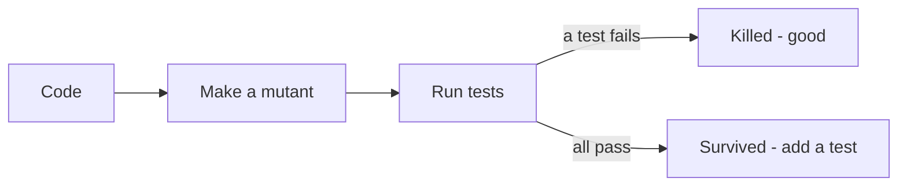

<TLDR>
Coverage tells you a line ran. It does not tell you a test would notice if the line were wrong. Mutation testing breaks your code on purpose and checks that a test fails. Property-based testing states a rule once and lets a tool try many inputs.
</TLDR>

## What and why

[Test coverage](/planning-strategy/test-coverage) measures which lines ran. A test with no assertion still gives 100% coverage.

**Mutation testing** answers "would my tests catch a bug?". A tool makes small changes (**mutants**), such as `==` to `!=`, and reruns the tests. If a test fails, the mutant is **killed**. If all tests pass, the mutant **survived**: a gap in your tests.

**Property-based testing** answers "does this rule hold for any input?". You describe the inputs and a property, such as "any title of 1 to 100 characters is accepted". The tool generates many inputs. When one fails, it **shrinks** it to a small failing case.

| | Finds that coverage cannot |
|---|---|
| Mutation testing | Tests that run code but do not check it |
| Property-based testing | Inputs you did not think of; rules that hold only for your examples |

## How it works



## When to use it (and when not to)

| Use it when | Skip it when |
|---|---|
| Logic is dense: rules, validation, state machines | The code is glue or configuration |
| You trust coverage numbers too much | The suite is slow. Mutation reruns it many times |
| A rule has a clear "for all inputs" statement | You cannot state the rule without copying the code |

:::tip Recommendation
Run mutation testing on one small, important module, not the whole repo. Use property tests to complement boundary examples from [Equivalence partitioning and boundary values](/test-design/equivalence-partitioning-and-boundaries), not replace them.
:::

## TaskFlow example

**Property-based.** `examples/taskflow/tests/test_properties.py` uses Hypothesis with the same `TestClient` pattern as `test_taskflow_api.py`. The `st.text(min_size, max_size)`, `settings` and `suppress_health_check` syntax is from the Hypothesis docs.

```python
@settings(max_examples=40, deadline=None,
          suppress_health_check=[HealthCheck.function_scoped_fixture])
@given(title=st.text(alphabet=text_chars, min_size=1, max_size=100))
def test_any_title_of_1_to_100_chars_is_accepted_and_returned_unchanged(client, title):
    r = create(client, title)
    assert r.status_code == 201, r.text
    assert r.json()["title"] == title
```

Other tests cover titles over 100 characters (422), any priority outside `LOW`, `MEDIUM`, `HIGH` (422) and each allowed priority (201). Real result: all 4 passed (Hypothesis 6.170.15). The suppressed health check exists because the `client` fixture is created once per test, not per example. Here it resets the data once, which is fine because each example creates its own task.

**Mutation.** The status transition check is re-implemented in `examples/taskflow/doubles/transitions.py`, with three tests for it. They give **100% line and branch coverage** (coverage.py 7.17.2). Install mutmut and coverage with `pip install -r requirements-extra.txt` in `examples/taskflow`. Running mutmut 3.8.1 on Python 3.12.8 uses this config (from the mutmut README):

```ini
[mutmut]
source_paths=doubles/transitions.py
pytest_add_cli_args_test_selection=tests/
```

Real result: 7 mutants, 5 killed, **2 survived**. The survivors changed the default in `TRANSITIONS.get(current, set())` to `None` and to nothing. No test uses an unknown status, so nobody noticed. Adding `assert not can_move("NOPE", "TODO")` kills them: with that fourth test, mutmut reported all 7 killed.

:::info[Run note]
mutmut copies the code into a `mutants/` folder and only copies test files from a folder named `tests` or `test`. With the tests beside the code, mutmut fails with "file or directory not found". The run above used a temporary folder, so the repo has no `mutants/` directory. mutmut needs fork support, so on Windows use WSL (per its README).
:::

## Do this

- Read each survivor with `mutmut show <name>`. Decide: missing test, or harmless change?
- Running Hypothesis creates a local `.hypothesis` folder in the working directory. Keep it out of git.
- Turn every shrunken failing example into a normal named test.

## Avoid this

- Chasing 100% mutation score. Some survivors do not matter.
- Properties that re-implement the code. Then the test and code share the same bug.
- Running mutation on the full suite on every commit.

## Further reading

- [Hypothesis docs](https://hypothesis.readthedocs.io/en/latest/) (checked 2026-11-06)
- [mutmut on GitHub](https://github.com/boxed/mutmut) (BSD-3-Clause per its page, as of 2026-11-06)
