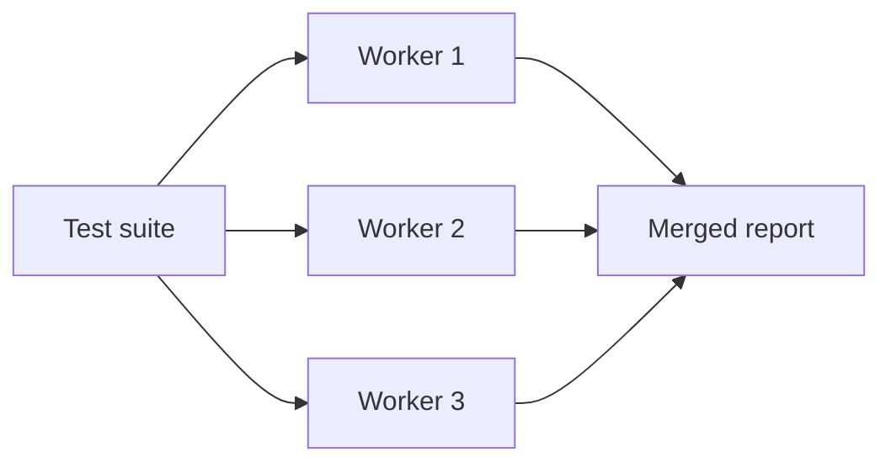

<TLDR>
Parallel execution runs several tests at the same time to finish sooner. It works well only when tests do not share data or state. Make tests independent first, then add workers, and split across machines only when one machine is too slow.
</TLDR>

## What and why

A suite that takes 40 minutes on one process can finish in about 10 with four workers, if the tests are independent. Faster feedback helps developers act on failures while the change is still fresh.

Parallel runs also reveal hidden dependencies. A test that passes alone may fail when another worker changes the same row at the same moment. Treat that as a bug in the test, and fix the shared state.

## How it works

There are two levels:

- **Parallel on one machine.** Several worker processes run tests from one suite. `pytest-xdist` does this for pytest. Its docs describe it as spreading runs across CPUs or remote machines.
- **Distributed.** Shards of the suite run on several machines, usually CI jobs. Each job runs a share of the tests, and results are merged.

Distribution strategy matters. Splitting by test file keeps related tests together. Splitting by individual test gives a more even load but can separate tests that share setup.



## When to use it (and when not to)

| Use it when | Skip it when |
|---|---|
| The suite is slow and the tests are independent | Tests share one database row and cannot be isolated yet |
| CI minutes are the bottleneck | The suite is a few seconds long |
| You need results on every pull request | You run a single smoke test |

## TaskFlow example

The local API tests can run in parallel with `pytest-xdist`. Each worker process imports `conftest.py`, which creates its own temporary SQLite file, so the workers do not write to the same database. Check this on your machine before you trust it, because a change to the config would break it.

```bash
cd examples/taskflow
. .venv/bin/activate
pip install pytest-xdist        # install into the venv first
pytest -n auto -q               # one worker per CPU
```

Run the suite once in serial mode and once with `-n auto`. Compare the pass count. Different results mean a hidden dependency.

## Do this

- Make each test create its own data before you add workers.
- Run the suite serially on every change of test data or fixtures, to catch order problems.
- Use `-n auto` locally and a fixed worker count in CI, so runs stay comparable.
- Recommendation: split CI work by file or by historical run time, not by alphabetical order alone.
- Recommendation: keep an eye on the slowest tests. One slow test can cap the whole run.

## Avoid this

- Adding workers to a suite that shares data. Failures then look random, which is a flaky-test problem.
- Using one shared test account that tests change at the same time.
- Measuring a speed-up without comparing the pass counts.

## Further reading

- [pytest-xdist documentation](https://pytest-xdist.readthedocs.io/en/stable/)
