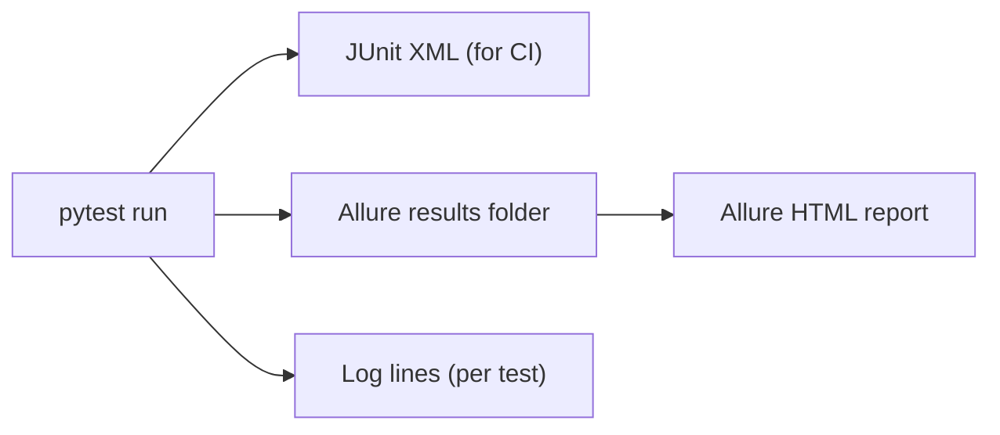

<TLDR>
A test report says what passed and failed. A log says why. Use JUnit XML so CI tools can read results, and Allure for a browsable report with steps and attachments. Log enough detail to diagnose a failure from the report alone.
</TLDR>

## What and why

When a test fails at 2 a.m. in CI, you need three things quickly: which test failed, what it was doing, and what the system returned. Reports and logs give you those.

Two formats are common:

- **JUnit XML** is a plain XML file that most CI systems read. It shows test names, outcomes and error messages. Almost every tool can produce it.
- **Allure** is an open-source reporting tool. Its docs describe it as turning test results into interactive HTML reports. It supports steps, titles and attachments such as screenshots.

## How it works



With pytest:

- `pytest --junitxml=report.xml` writes the JUnit file.
- `pytest --alluredir=allure-results` writes Allure results. Then run `allure serve allure-results` to view them.

Logs go to the console or a file. Capture them per test, so the output for a failing test is easy to find.

## When to use it (and when not to)

| Use it when | Skip it when |
|---|---|
| CI needs to show results on each pull request | You only run tests on your laptop and read the terminal |
| Stakeholders read the report, not the code | The suite is a handful of unit tests |
| A failure needs screenshots or API responses to explain | The failure message already says everything |

## TaskFlow example

Use Allure steps to name what the test does, and attach the response when an assertion fails. This sketch uses the `allure` package (allure-pytest) and was **not run**.

```python
import allure

@allure.step("Create a task with title of {length} characters")
def create_task(client, headers, length):
    return client.post("/api/tasks", headers=headers,
                       json={"title": "a" * length, "priority": "LOW", "project_id": 1})

def test_title_too_long_is_rejected(client):
    headers = login(client)     # helper from the existing test file
    r = create_task(client, headers, 101)
    allure.attach(r.text, name="response body", attachment_type=allure.attachment_type.TEXT)
    assert r.status_code == 422
```

The step name appears in the report. The attached body shows the server message next to the failure.

## Do this

- Always write JUnit XML in CI, so your CI tool can show failures in the pull request.
- Give tests and steps clear names that say the behaviour, not the code path.
- Attach the response, a screenshot or a trace on failure, not on every run, to save space.
- Recommendation: keep logs at INFO level in CI and DEBUG level when you investigate.
- Recommendation: keep reports for a fixed period, such as 14 days, and archive failed runs longer.

## Avoid this

- Logging passwords or tokens. Mask them before writing.
- Writing `print()` statements that vanish when the run ends. Use the test framework's capture.
- Using only the final pass or fail count. Look at the failure reasons too.

## Further reading

- [Allure Report documentation](https://allurereport.org/docs/)
