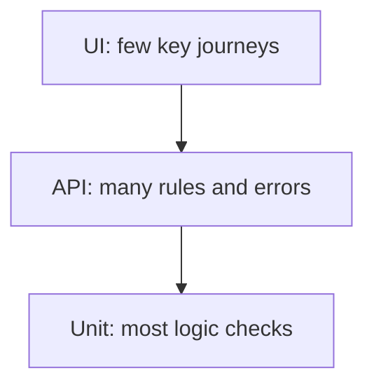

<TLDR>
The test automation pyramid is a guide for how many tests to write at each layer. Many fast unit tests sit at the base, fewer API tests in the middle, and a small number of UI tests at the top. It is a shape to aim for, not a rule to copy exactly.
</TLDR>

## What and why

Automated tests cost time to run, time to write and time to fix. Slow, broad tests break often and take long to diagnose. Fast, narrow tests are cheap to keep.

Martin Fowler's article "The Practical Test Pyramid" describes the idea as grouping tests into buckets of different granularity. The lower the bucket, the faster and more focused the tests.

The pyramid helps you answer: "Where should this check live?" If a rule can be checked at the API, do not check it through the UI.

## How it works

Each layer has a different job:

| Layer | What it checks | TaskFlow example | Speed |
|---|---|---|---|
| Unit | One function or class | Title length check in a validator | Milliseconds |
| API | Endpoints and rules | `POST /api/tasks` returns 422 for a 101-character title | Fast |
| UI | Screens and key journeys | Log in and see the task list | Slow |

The shape matters more than the exact numbers. Some teams write more API tests than unit tests because their logic lives in the API layer. That can still fit the idea.

## When to use it (and when not to)

| Use it when | Skip it when |
|---|---|
| You plan a new suite or review an old one | The product is a single static page with no logic |
| The UI suite takes too long or breaks often | Your team has no unit or API tests yet and needs a basic start first |
| You argue about where a test belongs | You use the pyramid as a rigid quota |

## TaskFlow example

Take the title rule from [Equivalence partitioning and boundary values](/test-design/equivalence-partitioning-and-boundaries): 1 to 100 characters.

- **Unit:** test the title validator with 0, 1, 100 and 101 characters. Runs in milliseconds.
- **API:** the existing `test_task_title_length_boundaries` in `examples/taskflow/tests/test_taskflow_api.py` checks the same four values through `POST /api/tasks`. It confirms the rule is wired up.
- **UI:** one test that creates a task with a valid title and sees it in the list. It does not repeat the boundaries.

The rule is tested in full at the lower layers. The UI test only proves the screen connects to the API.

## Do this

- Put each rule at the lowest layer that can check it.
- Keep the UI layer to a few journeys that matter to users.
- Recommendation: count tests per layer each quarter. If the UI count grows fast, move checks down.
- Recommendation: use the pyramid to plan, then check the real run times to confirm it.

## Avoid this

- Repeating the same boundary test at every layer. One layer is enough, plus one wiring check.
- Writing only UI tests because they feel closer to users.
- Treating the pyramid as a target count. The right mix depends on the product.

## Further reading

- [The Practical Test Pyramid, Martin Fowler](https://martinfowler.com/articles/practical-test-pyramid.html)
