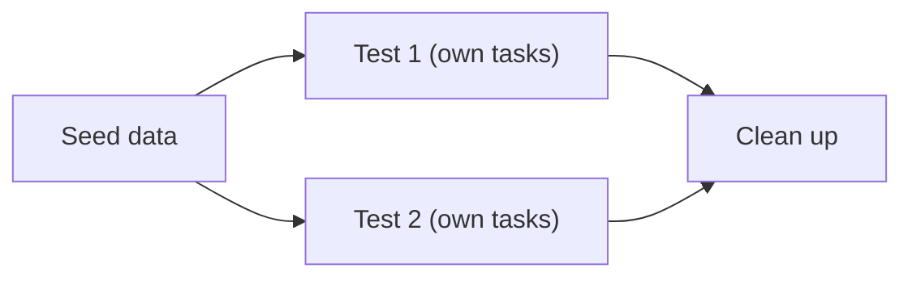

<TLDR>
Test data is the set of users, projects and records a test needs. Good test data is known before the test runs, isolated from other tests, and cleaned up afterwards. Use data-driven (parameterised) tests to run one test with many inputs.
</TLDR>

## What and why

Many test failures come from data, not from code. A test finds a project that another test has changed. A task title is already in use. A user was deleted by an earlier run.

Test data management is how you keep data predictable. It covers where data comes from, how each test gets its own copy, and how the data is removed.

## How it works

There are three common sources:

| Source | Good for | Risk |
|---|---|---|
| Seed data (fixed rows loaded at start) | Demo users and one project | Tests that change seed data affect others |
| Created per test (through the API or a builder) | Most tests | Slower if setup is heavy |
| Shared dataset file or database view | Large data sets, such as many rows | Hard to keep clean |

TaskFlow uses seed data for two demo users (`alice`, `bob`) and project `1`. Each test in `examples/taskflow/tests/test_taskflow_api.py` drops and recreates the database, so the seed data comes back clean.



## When to use it (and when not to)

| Use it when | Skip it when |
|---|---|
| Tests must not depend on each other | One test needs one fixed value and nothing else changes |
| The same rule needs many inputs | The data is huge and comes from production (see privacy rules in your company) |
| Tests run in parallel | You run one test on a laptop |

## TaskFlow example

The title rule has four boundary values. One parameterised test covers all four, and each run gets its own task:

```python
import pytest

@pytest.mark.parametrize("length, expected", [(0, 422), (1, 201), (100, 201), (101, 422)])
def test_title_length(client, length, expected):
    headers = login(client)     # helper from the existing test file
    r = client.post("/api/tasks", headers=headers,
                    json={"title": "a" * length, "priority": "LOW", "project_id": 1})
    assert r.status_code == expected
```

Each case is a separate test in the report, so a failure shows exactly which length broke. This is the same test as in the existing file, shown here as a data-driven pattern. For the rule itself, see [Equivalence partitioning and boundary values](/test-design/equivalence-partitioning-and-boundaries).

## Do this

- Create the data a test needs inside the test, or in a fixture that cleans up after itself.
- Use unique names, such as a short random suffix, when records must be unique.
- Keep production data out of tests. Use synthetic data that matches the shape you need.
- Recommendation: reset the database between runs, or use a fresh database per worker when you run in parallel.
- Recommendation: keep demo passwords in one config file, and never reuse them in production.

## Avoid this

- Relying on the order of tests, or on rows created by an earlier test.
- Sharing one "golden" project that many tests change.
- Hard-coding ids that depend on the current database state. Read the id from the response instead.
