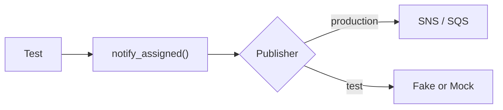

<TLDR>
A test double is a stand-in for something your code depends on, such as a message queue or another service. Pick the simplest kind that makes the test fast and stable. Use a virtual service (WireMock) when the dependency is a real HTTP API and you want to test over the wire.
</TLDR>

## What and why

Your code often calls things you do not control in a test: a queue, a payment API, the clock. Calling the real thing is slow, costs money, or fails at random. A **test double** is a stand-in, like a stunt double in a film.

| Double | What it does | Plain example |
|---|---|---|
| Dummy | Fills a parameter. Never used. | Passing `None` where the code ignores the argument |
| Stub | Returns fixed answers. | A clock that always says `1000.0` |
| Fake | A simple but working version. | An in-memory queue instead of SQS |
| Mock | Records calls, then checks them. | "`publish` was called once with this event" |
| Spy | A real object that also records calls. | The real publisher, wrapped so you can count calls |

Stubs and fakes help you check **state** (what came out). Mocks and spies help you check **behaviour** (what was called). Mocks tie a test to how the code works inside, so a refactor can break them. Use them for calls that leave the process, such as "was the email sent?".

## How it works



Pass the dependency in as a parameter (dependency injection). Then the test hands in a double and production hands in the real thing.

**Service virtualization** goes one step further. Instead of replacing a Python object, you run a fake *server* that speaks real HTTP. Your code makes real network calls and gets canned answers. Two tools are common:

- **WireMock** is an open-source HTTP mocking tool. It supports stubbing, request verification, record and playback, and fault and latency injection, and it runs as a library, a standalone server or a Docker container. Its repository states the Apache-2.0 licence (as of 2026-11-06, source below). Evidence class: documented by the project itself.
- **Testcontainers** starts throwaway Docker containers from test code and removes them afterwards. It has a Python library, and its site says Docker is all you need. Its Python repository states the Apache-2.0 licence (as of 2026-11-06). Use it to start a WireMock container for the test run.

The WireMock snippet below is **not run**: it needs Docker, which was not used for this page.

## When to use it (and when not to)

| Use it when | Skip it when |
|---|---|
| The dependency is slow, costly, flaky or not built yet | You can use the real thing cheaply (SQLite, an in-process app) |
| You need failures: timeouts, 500s, a broker that is down | The double would copy so much logic that you test the double |
| You want fast unit tests on the lower layers | You need proof the two sides agree. Add a contract test |

:::tip Recommendation
Prefer a fake over a mock when you can. Fakes survive refactors. Keep a few real-integration tests so a double never hides a broken contract. See [Integration and contract testing](/testing-by-layer/integration-and-contract-testing).
:::

## TaskFlow example

In the reference architecture, `task-service` publishes a `task.assigned` event and `notification-service` reads it (see [Microservices and event-driven testing](/testing-by-layer/microservices-and-event-driven-testing)). Locally there is no queue. The runnable code lives in `examples/taskflow/doubles/`, not in `app/`.

```python
# doubles/notifications.py
def notify_assigned(publisher, task_id, assignee_id, clock=time.time):
    if assignee_id is None:
        raise ValueError("task has no assignee")
    event = {"type": "task.assigned", "task_id": task_id,
             "assignee_id": assignee_id, "at": clock()}
    try:
        publisher.publish("task.assigned", event)
    except ConnectionError:
        publisher.publish("task.assigned", event)  # one retry
    return event
```

The tests use a hand-written fake (state check) and `unittest.mock.Mock` (behaviour check):

```python
class FakePublisher:
    def __init__(self, fail_first=0):
        self.messages, self._fail = [], fail_first
    def publish(self, topic, event):
        if self._fail:
            self._fail -= 1
            raise ConnectionError("broker down")
        self.messages.append((topic, event))

def test_mock_with_side_effect_checks_retry():
    publisher = Mock()
    publisher.publish.side_effect = [ConnectionError("down"), None]
    notify_assigned(publisher, 7, 2)
    assert publisher.publish.call_count == 2
```

Real result on this machine (Python 3.12.8, pytest 8.3.4): `pytest -q doubles` gave `9 passed` (6 notification tests, 3 transition tests used on the mutation page).

For the virtual-service route, a WireMock stub is a JSON mapping, posted to `/__admin/mappings`. The `fixedDelayMilliseconds` field is from the WireMock docs (checked 2026-11-06):

```json
{"request": {"method": "GET", "url": "/users/2"},
 "response": {"status": 200, "fixedDelayMilliseconds": 2000}}
```

```python
# Not run: needs Docker. API names checked in the testcontainers-python docs.
from testcontainers.core.container import DockerContainer
c = DockerContainer("wiremock/wiremock").with_exposed_ports(8080)
c.start()
port = c.get_exposed_port(8080)   # random free host port
```

## Do this

- Inject dependencies, so a double fits in without patching.
- Stub time and randomness. Tests that read the real clock become flaky (see [Flaky tests](/automation-engineering/flaky-tests)).
- Test the failure path with a double: the retry, the timeout, the 500.
- Keep one real end-to-end check per important dependency.

## Avoid this

- Mocking everything. A test that only checks mocks proves nothing.
- Asserting exact call order when order does not matter.
- Letting a double drift from the real service. Update both together.

## Further reading

- [WireMock documentation](https://wiremock.org/docs/) (checked 2026-11-06)
- [Testcontainers](https://testcontainers.com/) (checked 2026-11-06)
