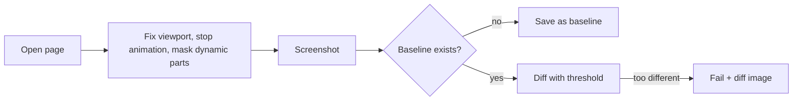

<TLDR>
Visual regression testing takes a screenshot and compares it with an approved one. It finds broken layouts and styles that functional tests miss. It is flaky by nature, so you fix the viewport, freeze animation and mask anything that changes.
</TLDR>

## What and why

A functional UI test can pass while the button is hidden behind a banner, because the element still exists. A **visual regression test** compares pixels. The first run saves a **baseline** image. Later runs take a new screenshot and diff it.

Why it is flaky:

- **Fonts.** Each OS draws text slightly differently. A baseline made on a Mac fails on Linux CI.
- **Animation.** A screenshot mid-fade differs from one after the fade.
- **Dates and random data.** Clocks, tokens, ids and "3 minutes ago" change every run.
- **Viewport and scale.** Another window size or pixel density changes every pixel.

## How it works



Ways to tame it:

| Problem | Fix |
|---|---|
| Different machines | Make baselines in the same container image CI uses |
| Animation | `animations="disabled"` |
| Changing data | Mask the element, or fix the data |
| Tiny anti-aliasing noise | A threshold: per-pixel tolerance and a maximum share of differing pixels |
| Size drift | Fixed viewport and `device_scale_factor=1` |

## When to use it (and when not to)

| Use it when | Skip it when |
|---|---|
| A design system or marketing page must look right | The UI changes daily and nobody reviews diffs |
| You refactor CSS | You can only test on developers' laptops with mixed OSes |
| A few key screens matter | Content is mostly dynamic |

## TaskFlow example

:::warning Python Playwright limitation
The Playwright docs describe `toHaveScreenshot` for the Node test runner. In Playwright for Python 1.64.1, `expect(page)` has **no** `to_have_screenshot` (neither the installed `PageAssertions` class nor the Python screenshots docs has it; the docs only describe `page.screenshot()`). So `examples/taskflow/visual/test_visual.py` uses `page.screenshot()` for the capture and Pillow 13.0.0 for the comparison. Install the packages with `pip install -r requirements-extra.txt` in `examples/taskflow`, then run `python -m playwright install chromium` once.
:::

The `page.screenshot()` options `animations="disabled"`, `caret="hide"` and `mask=[locator]` are from the Playwright Python docs (checked 2026-11-06).

```python
@pytest.fixture()
def page():
    with sync_playwright() as p:
        browser = p.chromium.launch()
        ctx = browser.new_context(viewport={"width": 800, "height": 700},
                                  device_scale_factor=1)
        yield ctx.new_page()
        browser.close()

def test_after_login_masks_the_dynamic_log(page):
    page.goto(BASE_URL)
    page.get_by_test_id("login").click()
    page.wait_for_function("document.getElementById('who').textContent === 'Logged in'")
    # The log box shows a random token, so cover it with a mask.
    shot(page, "after-login", mask=[page.get_by_test_id("log")])
```

The compare step counts pixels that differ by more than 16 (of 255) and fails above 0.1% of the image. A third test applies a CSS change (red, larger heading) and checks that the comparison really fails.

Real results (server on port 8102, Chromium headless shell 156.0.8078.4, Playwright 1.64.1, Python 3.12.8):

```text
run 1 (no baseline):  3 passed in 1.21s   # baselines created
run 2 (compare):      3 passed in 1.24s
```

Baselines are about 29 KB and 30 KB. They are generated at run time and ignored by `visual/.gitignore`, because they depend on the OS and fonts. Run it: start the API with `DATABASE_URL=sqlite:////tmp/agent2.db uvicorn app.main:app --port 8102`, then `BASE_URL=http://127.0.0.1:8102 pytest -q visual`.

## Do this

- Generate baselines in CI, in the same image that compares them.
- Review every diff image by a human before you approve a new baseline.
- Screenshot components or key screens, not every page.
- Mask or fix the clock and random data (see [Flaky tests](/automation-engineering/flaky-tests)).

## Avoid this

- Committing baselines made on a laptop and comparing them on Linux CI.
- A threshold so high that real bugs pass.
- Auto-approving diffs to make the build green.

## Further reading

- [Playwright Python: screenshots](https://playwright.dev/python/docs/screenshots) (checked 2026-11-06)
