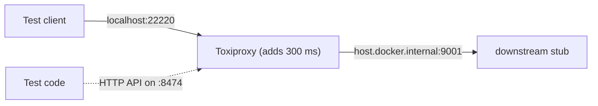

<TLDR>
This page turns the ideas in [Reliability, resilience and chaos engineering](/other-non-functional/reliability-and-chaos) into a test you can run. A proxy called Toxiproxy sits between a client and a dependency, adds 300 ms of delay, and the test checks what the client sees. The example runs in `examples/taskflow/chaos/`. Without Docker and Toxiproxy, the test is skipped.
</TLDR>

## What and why

A **fault injection** tool breaks a connection on purpose. It can add delay, cut data, or drop a connection. The goal is to see how your code behaves when a dependency misbehaves. The reliability page explains why this matters. This page shows how to do it once, on a laptop.

**Toxiproxy** is an open source TCP proxy from Shopify. Your code connects to Toxiproxy instead of the real service. Toxiproxy forwards the bytes. You add a **toxic** to a proxy, such as latency, and it changes the traffic. The project's README says Toxiproxy "listens for HTTP on port 8474", and that is where you add and remove toxics. Source: [Toxiproxy on GitHub](https://github.com/Shopify/toxiproxy). Checked 2026-11-06.



## How it works

There are three moving parts:

1. **The stub.** `chaos/downstream_stub.py` is a small FastAPI app on port 9001. `GET /ping` returns a fixed JSON reply. It stands in for a dependency, because TaskFlow has no database or downstream service in the local app.
2. **The proxy.** Toxiproxy listens on port 22220 and forwards to the stub. The test creates this proxy through the HTTP API.
3. **The toxic.** The test adds a `latency` toxic to the downstream direction with a value of 300 ms.

Toxiproxy runs in Docker. The Docker image exposes only port 8474, so the proxy port must be published too.

## When to use it (and when not to)

| Use it when | Skip it when |
|---|---|
| You want to see how a timeout behaves with a slow dependency | The test would touch a shared or production system |
| You can run a local stand-in for the dependency | You have no expected behaviour written down |
| You want one fault, one dependency, one short window | You want to inject several faults at once on the first try |

## TaskFlow example

The test file is `examples/taskflow/chaos/test_fault_injection.py`. The core check adds the latency toxic, then calls the proxy with a 5-second timeout:

```python
def test_latency_toxic_adds_about_300ms(proxy):
    _add_latency(proxy, 300)

    start = time.perf_counter()
    resp = httpx.get(CLIENT_URL, timeout=5)
    elapsed = time.perf_counter() - start

    assert resp.status_code == 200
    assert resp.json()["service"] == "downstream-stub"
    assert elapsed >= 0.28, f"expected at least ~300 ms, got {elapsed:.3f} s"
```

The second test adds the same toxic, then calls with `timeout=0.1`. It asserts that `httpx.TimeoutException` is raised and that the client gave up in under one second. It does not assert a retry policy, because TaskFlow's client has none to test.

The `proxy` fixture creates the proxy through `POST /proxies`, and it calls `POST /reset` and deletes the proxy afterwards. The test calls the HTTP API directly. The Python client `toxiproxy-python` wraps the same API, but the direct calls keep each step visible.

**Run it.** Start Toxiproxy, then run the chaos folder. The TaskFlow requirements already include FastAPI and uvicorn, which the stub needs.

```bash
docker run -d --name toxiproxy -p 8474:8474 -p 22220:22220 \
  --add-host=host.docker.internal:host-gateway ghcr.io/shopify/toxiproxy
cd examples/taskflow
python3 -m pytest chaos/test_fault_injection.py -v
docker rm -f toxiproxy
```

The `--add-host` flag lets the container reach the stub on your machine. Docker Desktop on macOS already provides `host.docker.internal`, so the flag is harmless there. On Linux, a container reaches the host through the host gateway, not through `127.0.0.1`. For that reason the test starts the stub with `--host 0.0.0.0`, which makes it listen on every network interface. This is fine for a local test, but do not leave it running on a shared or public network.

Real output from one run in this repository, with Toxiproxy 2.13.0 reporting its version at `/version`:

```
chaos/test_fault_injection.py::test_latency_toxic_adds_about_300ms PASSED [ 50%]
chaos/test_fault_injection.py::test_timeout_of_100ms_fails_cleanly_under_latency PASSED [100%]
============================== 2 passed in 1.55s ==============================
```

**Without Toxiproxy.** The tests use `@pytest.mark.skipif`, so they skip when `localhost:8474` does not answer. The offline suite does not collect this folder, so it stays green. Real output from the same run after the container was removed:

```
SKIPPED [1] chaos/test_fault_injection.py:89: Toxiproxy is not reachable at localhost:8474. Start it with docker run (see the fault-injection chapter).
SKIPPED [1] chaos/test_fault_injection.py:102: Toxiproxy is not reachable at localhost:8474. Start it with docker run (see the fault-injection chapter).
============================== 2 skipped in 0.04s ==============================
```

**Dropped connections.** This example injects latency only. Toxiproxy also has toxics that cut or reset data. Its README lists them. Try one as an exercise, with a single new test, and keep the expected behaviour written first.

## Do this

- Write the expected behaviour before you run the test. For example, "a 100 ms timeout fails in under one second."
- Use a fixed, named proxy and reset state after each test, so runs do not leak toxics.
- Keep the stub, the proxy and the test in a test environment. Never point a proxy at a production service.
- Check that the test skips cleanly without Docker, so your offline suite still runs.
- Change one fault at a time.

## Avoid this

- Asserting a retry count when the client has no retry policy yet. Test the failure, not the policy.
- Using a fixed sleep to wait for Toxiproxy. Poll its `/version` endpoint instead.
- Leaving a proxy running after a failed run. Reset it in the fixture teardown.

## Further reading

- [Toxiproxy on GitHub](https://github.com/Shopify/toxiproxy). Checked 2026-11-06. The README covers the HTTP API, the toxic types and the Docker image.
