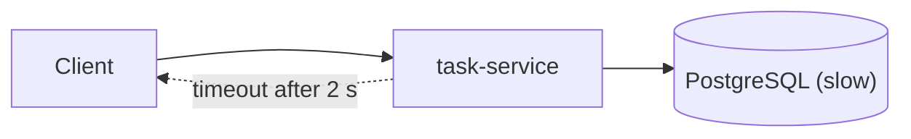

<TLDR>
Reliability testing checks that a system keeps working, or fails safely, when something goes wrong. Chaos engineering breaks a part of the system on purpose, in a controlled way, to test a guess about how it reacts. The best place to start is a small failure, such as a slow database, in a test environment.
</TLDR>

## What and why

Reliability means the system does its job, most of the time. **Resilience** means it recovers well when a part fails. Both are easy to assume and hard to prove.

Most outages start with a dependency that is slow, not dead. A database that takes 10 seconds instead of 10 milliseconds can hurt more than one that is simply down. Slow calls hold threads, connections and user patience.

**Chaos engineering** is a way to test these cases. Its principles, from [principlesofchaos.org](https://principlesofchaos.org/) (checked 2026-11-06), are:

1. Define "normal" with measurable behaviour, such as "95% of task reads finish in under 300 ms" (an example target, not a TaskFlow requirement).
2. Form a hypothesis: "If the database is slow, task reads still return an error within 2 seconds."
3. Inject a real-world failure, such as added latency, a dropped connection or a crashed process.
4. Compare what happened with the hypothesis.
5. Limit the **blast radius**, which is the amount of users and systems the test can affect.

## How it works

Common failure types to inject:

- **Latency:** a call takes longer than normal.
- **Errors:** a call returns 500 or times out.
- **Loss:** a process dies, or a network link is cut.

Good systems protect callers with a few patterns:

- **Timeouts:** stop waiting after a set time.
- **Retries:** try again. Retry only safe operations, such as reads or operations that are [idempotent](/start-here/glossary).
- **Circuit breakers:** stop calling a failing dependency for a while.
- **Bulkheads:** keep one slow part from using every thread or connection.

## When to use it (and when not to)

| Use it when | Skip it when |
|---|---|
| A service depends on a database, queue or other service | You have no monitoring to see what happened |
| You have had an outage that was not understood | The system is still broken in basic ways |
| You have a rollback path and a safe test environment | You would test in production with no limits |

Build the basics first: timeouts, retries and alerts. Chaos tests only help when the system already has the parts they check.

## TaskFlow example

TaskFlow's production design uses RDS PostgreSQL behind `task-service` (see [the TaskFlow reference](/start-here/taskflow-reference)). Here is a thought experiment about a slow database. No experiment was run for this handbook.

**Hypothesis.** When PostgreSQL takes 10 seconds to answer, `GET /api/tasks/{id}` returns a clear error within 2 seconds. It does not hang.

**What we would expect to see if the system has no timeout:**

- Each read waits about 10 seconds.
- Requests pile up. Connections and worker threads fill.
- The load balancer sees slow responses. Other reads start to fail too.
- The user sees a spinner, then a timeout.

**What the local app does.** It sets no query timeout of its own. So this hypothesis would probably fail today. That is what the test is for.

**Other things to check:**

- `PUT /api/tasks/{id}` changes the status. If the database fails halfway, the status must not change partly.
- `POST /api/tasks` is not idempotent. A client retry after a timeout can create two tasks. Use a client-side key or check before retrying. The HTTP rules are in [RFC 9110](https://www.rfc-editor.org/info/rfc9110/), section on methods.
- When the database recovers, reads should work again without a restart.

In a test environment, a proxy or a fault-injection tool can add latency to the database connection. Start with one service, one dependency and a short window.

## Do this

- Write the expected behaviour before you inject the fault.
- Set timeouts on every call to another service and to the database.
- Start in a test environment with a clear stop button.
- Watch the metrics and logs during the test, not only the result. See [observability for testers](/modern-quality-engineering/observability-for-testers).
- Write down what you learned and fix one thing at a time.

## Avoid this

- Running chaos tests in production before you have basic monitoring.
- Injecting several faults at once in your first test.
- Retrying unsafe writes automatically.

## Further reading

- Principles of Chaos Engineering. Checked 2026-11-06.
- RFC 9110, HTTP Semantics. Checked 2026-11-06. Defines which methods are idempotent.
