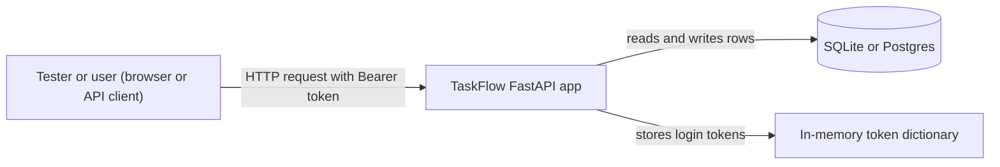

<TLDR>
Threat modelling is a structured way to ask "how could someone abuse this system?" before you test. You draw how data moves, sort each risk into a STRIDE category, and turn each risk into a test. This page does that for TaskFlow. None of the tests below were run for this page.
</TLDR>

## What and why

A **threat** is a possible attack or misuse. A **threat model** records the threats you thought about, how bad they are, and what you do about each one.

Testers already think in cases: "what if the user does this?" Threat modelling adds one question: "what if an attacker does this?" It moves security checks earlier, when fixes are cheaper, and it gives you tests based on the design.

The usual steps are: draw the system, find the threats, decide what to do about each one, and check the answer. The OWASP Threat Modeling Cheat Sheet (see further reading) describes the same process.

## How it works

### STRIDE

STRIDE is a set of six threat categories. [Microsoft's threat modelling documentation](https://learn.microsoft.com/en-us/azure/security/develop/threat-modeling-tool-threats) uses it to turn vague worry into specific questions.

| Letter | Category | Question to ask |
|---|---|---|
| S | Spoofing | Can someone pretend to be another user? |
| T | Tampering | Can someone change data they should not change? |
| R | Repudiation | Can someone deny an action, with no record to prove it? |
| I | Information disclosure | Can someone read data they should not see? |
| D | Denial of service | Can someone make the service unavailable to others? |
| E | Elevation of privilege | Can someone gain rights they were never given? |

### Data-flow diagrams

A **data-flow diagram** shows the parts of a system, the data that moves between them, and the **trust boundaries**: where data crosses from less trusted code to more trusted code. Threats cluster at those lines.

## When to use it (and when not to)

| Use it when | Skip it when |
|---|---|
| You add a login, a role, a sharing rule or an external service | The change only alters a label or a colour |
| The system handles personal data or money | Nobody will act on the findings |

## TaskFlow example

The local app (`examples/taskflow/`) has three parts that matter here: the browser or API client, the FastAPI app, and the database. Login tokens live in an in-memory dictionary in `app/main.py`. The diagram uses the parts of the [TaskFlow reference](/start-here/taskflow-reference) that the local app has.



The line between the first box and the API is the main trust boundary. Everything that crosses it is untrusted until the app checks it.

Four threats follow from this diagram and the code. **Status of every test below: not run.**

| # | STRIDE | Threat | What the code does today |
|---|---|---|---|
| T1 | Spoofing | Someone guesses a password by trying many logins | `POST /api/auth/login` has no rate limit |
| T2 | Information disclosure | A non-member reads a task by its ID | `GET /api/tasks/{id}` runs the membership check |
| T3 | Tampering | A user skips workflow steps, for example TODO to DONE | `PUT /api/tasks/{id}` checks allowed status moves |
| T4 | Spoofing | A stolen token keeps working for ever | Tokens never expire, and there is no logout endpoint |

**T1 test: many wrong passwords.** Send 50 wrong passwords for `alice` and record each status code. From the code, we expect 50 times 401 and no 429. A good design would return 429 after a few tries. Sketch, not run:

```python
from fastapi.testclient import TestClient
from app.main import app

def test_login_is_rate_limited():
    with TestClient(app) as client:
        codes = [client.post("/api/auth/login",
                             json={"username": "alice", "password": f"wrong-{i}"}).status_code
                 for i in range(50)]
    assert 429 in codes   # not run; expected to fail on the current code
```

**T2 test: non-member read.** Alice creates a project with only herself as a member. Log in as `bob`, who is not in it, and call `GET /api/tasks/{id}` for her task. Expected: 403.

**T3 test: illegal status move.** As a project member, create a task (status `TODO`) and send `PUT` with `"status": "DONE"`. Expected: 409, because the rules do not allow that move.

**T4 test: token lifetime.** Log in, keep the token, and call a task endpoint again after a long wait. Expected after a fixed lifetime: 401. Today the token has no lifetime, so the test would show 200. A practical version needs a short token lifetime in a test-only build.

:::info[Expected results, not measurements]
The results above are what the code suggests. None of these tests was run for this page.
:::

## Do this

- Draw the data-flow diagram before you write the test plan.
- For each threat, write one test that could fail, and name its STRIDE category.
- Record the actual status codes and the request you sent.
- Prefer tests with two users: the owner and a stranger (see [security testing fundamentals](/other-non-functional/security-testing)).

## Avoid this

- Writing a threat model that nobody reads. Link each threat to a test or a backlog item.
- Treating STRIDE as a form to fill in. Use it to ask questions.

## Further reading

- [Microsoft: Threats in the Threat Modeling Tool (STRIDE)](https://learn.microsoft.com/en-us/azure/security/develop/threat-modeling-tool-threats). Checked 2026-11-06.
- [OWASP Threat Modeling Cheat Sheet](https://cheatsheetseries.owasp.org/cheatsheets/Threat_Modeling_Cheat_Sheet.html). Checked 2026-11-06.
