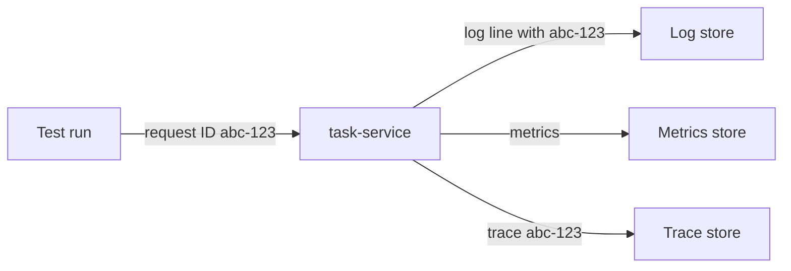

<TLDR>
Observability means you can work out what a system is doing from the data it emits. The three main kinds of data are logs, metrics and traces. Testers use them to find out why a test failed, and to check that a system behaves as expected under load or failure.
</TLDR>

## What and why

A test tells you that something failed. It rarely tells you why. Observability data fills that gap.

- **Logs** are timestamped text lines about events. For example: "task 42 status changed from IN_REVIEW to DONE, user alice".
- **Metrics** are numbers collected over time. For example: requests per second, error count or p95 latency.
- **Traces** follow one request across services. They show each step and how long it took.

Testers need all three. Logs answer "what happened?". Metrics answer "how often, and since when?". Traces answer "where did the time go?".

## How it works

[OpenTelemetry](https://opentelemetry.io/docs/) is an open, vendor-neutral way to produce and send logs, metrics and traces. (Checked 2026-11-06.) Many monitoring products can read its data.

A useful habit is a **correlation ID**. Each incoming request gets an ID. That ID is written into every log line and passed to the next service. Then one search finds all the lines for one test.

| Signal | Good question for a tester |
|---|---|
| Logs | Which request failed, and what error did it return? |
| Metrics | Did the error rate rise after the change? By how much? |
| Traces | Which step in the request was slow? |

For performance work, the USE and RED checklists help you pick metrics. See [finding bottlenecks](/performance-fundamentals/finding-bottlenecks).

## When to use it (and when not to)

| Use it when | Skip it when |
|---|---|
| A test fails and the reason is not clear from the assertion | The test is a pure unit test with no I/O |
| You run load or failure tests | You are checking one value in a static page |
| You need evidence for a release decision | You would log personal data to get more detail |

Never log passwords, tokens or personal data. Mask them before they reach the log.

## TaskFlow example

The local app is small. It has a `/health` endpoint (`GET /health` returns `{"status": "ok"}`). It does not build in metrics or traces, so you see request lines in the terminal where `uvicorn` runs. See [the TaskFlow reference](/start-here/taskflow-reference).

A useful exercise:

1. Give each test run a unique title, such as `test-run-7f3a title`. Use it in the task title.
2. Run the test and note the time.
3. Search the `uvicorn` output for the time window and for the title.
4. If a request returns 500, the log line should show the error. If it returns 422, the body should show which field failed.

For a team version, add a request ID header in the app and write it into each log line. That is a recommended change, not a feature of the current code.

:::tip
When a test fails, check in this order: the test's own output, the service logs for the same time, then metrics for the same window, then traces if you have them.
:::

## Do this

- Include a unique run ID in test data, so you can find the test's requests in logs.
- Check `/health` before a test run, to fail fast if the service is down. (Recommendation)
- Compare metrics before and after a change, using the same time window and load.
- Use one vocabulary for names, such as `task-service` and `status_changed`.
- Keep log levels sensible. Debug logs are useful in tests and noisy in production.

## Avoid this

- Relying on the test assertion message as the only evidence.
- Logging secrets, tokens or personal data.
- Reading an average latency alone. Use percentiles such as p95. See [performance metrics](/performance-fundamentals/performance-metrics).

## Further reading

- [OpenTelemetry documentation](https://opentelemetry.io/docs/). Checked 2026-11-06. Describes OpenTelemetry as a vendor-neutral, open-source framework for telemetry data.
