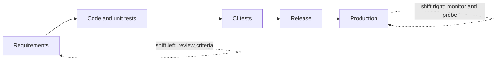

<TLDR>
Shift-left means finding problems earlier, while work is still in requirements or code. Shift-right means learning from real use after release, through monitoring and controlled production checks. Good teams do both, because each one finds problems the other misses.
</TLDR>

## What and why

Bugs cost more the later you find them. A wrong requirement found in a review takes minutes to fix. The same mistake found after release can mean a hotfix, a support call and an angry customer.

**Shift-left** moves testing toward the start of the lifecycle. **Shift-right** moves some testing toward the end, after release, where real users and real traffic show problems that test environments cannot.

See [the SDLC and STLC chapter](/fundamentals/sdlc-and-stlc) for the stages.

## How it works

Typical shift-left activities:

- Review requirements for testability before coding starts. See [requirements and testability](/planning-strategy/requirements-and-testability).
- Write acceptance criteria as examples.
- Run unit and API tests on every commit.
- Add static checks such as linting and dependency scanning.

Typical shift-right activities:

- Monitor error rates and latency by endpoint.
- Run synthetic checks that act like a user on a schedule.
- Release to a small group first, then widen (see [testing in production](/modern-quality-engineering/testing-in-production)).
- Use real failure reports to add tests for the next release.

## When to use it (and when not to)

| Use it when | Skip it when |
|---|---|
| Requirements are unclear or change often | The change is a one-line text fix with a full automated test |
| Defects keep reaching production | You have no monitoring yet, so shift-right has no signal |
| Several teams depend on one interface | You would expose real customers to unproven code |

Shift-right is not a replacement for testing before release. It adds a safety net.

## TaskFlow example

**Shift-left.** The business rule says a task title has 1 to 100 characters. In the requirements review, ask: "What happens with 0 characters, 100 characters, 101 characters, and a title that is only spaces?" The answers become test cases before any code exists. The boundary values come from [equivalence partitioning and boundaries](/test-design/equivalence-partitioning-and-boundaries).

**Shift-right.** After release, track the share of `POST /api/tasks` calls that return 422 by reason. A sudden rise in "title too long" could mean a front-end change broke the length check. The alert points to a problem that the pre-release tests did not cover.

:::info[Illustrative data]
The example above is a plan, not a measured result. No production traffic was observed for this handbook.
:::

Both activities use the same rules from [the TaskFlow reference](/start-here/taskflow-reference).

## Do this

- Review each story for testable acceptance criteria before development starts. (Recommendation)
- Put fast checks in CI so problems are found at the commit, not at release.
- Add a monitor for each critical user journey after release.
- Turn each production defect into a regression test.
- Keep production checks read-only where you can, or use a dedicated test account.

## Avoid this

- Believing shift-left removes the need for system tests.
- Running heavy production tests without a rollback plan.
- Measuring only pre-release test counts and ignoring what users see.

## Further reading

No external links for this chapter. The two ideas are shown here as a team practice, not as a formal standard.
