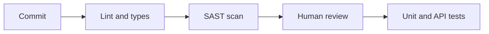

<TLDR>
Static analysis reads code without running it. Linters, type checkers and security scanners (SAST) are cheap, fast and run on every commit. Code review is the human version. Both are testing in ISTQB terms, and both miss things tests find, so use them together.
</TLDR>

## What and why

**Static testing** means examining code or documents without executing them. It fits the idea in [Shift left and shift right](/modern-quality-engineering/shift-left-and-shift-right): find defects early, when they are cheap to fix.

| Tool type | Finds | Example |
|---|---|---|
| Linter | Style problems, unused code, risky patterns | Ruff |
| Type checker | Wrong types passed around | mypy, pyright |
| SAST (static application security testing) | Known insecure patterns | Bandit, Semgrep, SonarQube |
| Code review | Wrong logic, missing tests, unclear names, design flaws | A teammate |

Tool facts, each from the project's own docs as of 2026-11-06 (vendor descriptions, not independent evidence):

- **Ruff**: "An extremely fast Python linter and code formatter, written in Rust".
- **Bandit**: "a tool designed to find common security issues in Python code".
- **Semgrep**: its docs say it finds bugs and vulnerabilities, with SAST, dependency (SCA) and secrets scanning.
- **SonarQube Server**: a self-managed static analysis and code review tool covering many languages. Quality gates can block flagged code from reaching production.

## How it works



Automated checks run first because they are quick and impartial. Review then spends human attention on what a machine cannot judge.

## When to use it (and when not to)

| Use it when | Skip it when |
|---|---|
| Always in CI, on every pull request | You treat every warning as a blocker with no triage |
| You want consistent style without arguments | Rules are copied in and nobody understands them |
| Code review: any change that affects behaviour | Review is only a rubber stamp |

## TaskFlow example

Read only: `examples/taskflow/app/` was not changed. Versions: ruff 0.17.4, bandit 1.9.4. Install both with `pip install -r requirements-extra.txt` in `examples/taskflow`.

```text
$ ruff check app --output-format concise
app/main.py:160:40: B008 Do not perform function call `Depends` in argument defaults ...
... (8 findings in total, all B008, on lines 160 to 239)
Found 8 errors.
```

Ruff flags FastAPI's normal `Depends()` pattern as B008. That is a **false positive** for this framework, a reminder to configure the linter instead of obeying it blindly.

```text
$ bandit -r app -q        # output condensed
>> Issue: [B106:hardcoded_password_funcarg] Possible hardcoded password: 'alice-pass'
   Severity: Low   Confidence: Medium   CWE-259
   Location: app/main.py:72:12
>> Issue: [B106:hardcoded_password_funcarg] Possible hardcoded password: 'bob-pass'
   Location: app/main.py:73:10
Total issues: Low 2, Medium 0, High 0   (191 lines scanned)
```

These two are true findings, but known: the demo seeds users with plain-text passwords on purpose. The app's header comment says "DEMO ONLY".

**What the tools did not say.** `login` compares `user.password != body.password`, so passwords are stored and compared in plain text. Neither tool flagged that design flaw. A reviewer should. Also, the in-memory `TOKENS` dictionary has no expiry. A scanner cannot know your intent, so review and [Security testing](/other-non-functional/security-testing) still matter.

## Code review as a testing activity

Review the tests as well as the code. Ask:

- What could break? Is there a test for it?
- Are the edge cases covered (empty, maximum length, wrong role)?
- Would this test fail if the code were wrong? (See the mutation page, [Mutation and property-based testing](/automation-engineering/mutation-and-property-based-testing).)

## Do this

- Run linter and SAST in CI and fail the build only on rules the team agreed on.
- Suppress a false positive with a comment and a reason, not silently.
- Keep pull requests small. Reviewers miss more in large ones.
- Use a short review checklist for tests (see [Maintaining automation](/automation-engineering/maintaining-automation)).

## Avoid this

- Fixing warnings in bulk without reading them.
- Treating a clean scan as proof of security.
- Reviewing only style. Machines do that.

## Further reading

- [Bandit documentation](https://bandit.readthedocs.io/en/latest/) (checked 2026-11-06)
- [Ruff documentation](https://docs.astral.sh/ruff/) (checked 2026-11-06)
- [Semgrep documentation](https://docs.semgrep.dev/) (checked 2026-11-06; the SonarQube docs at docs.sonarsource.com were checked the same day)
