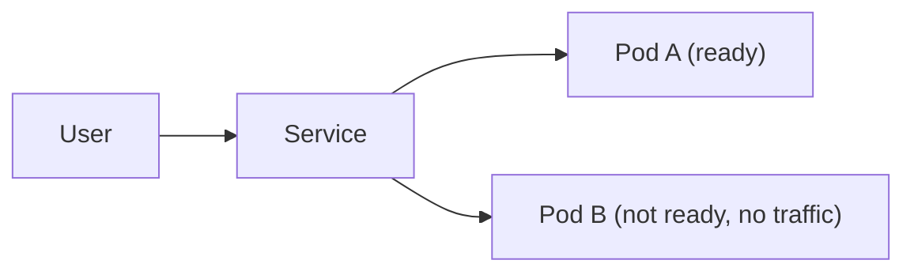

<TLDR>
Kubernetes runs containers and keeps them healthy. Testers need four ideas: pods, deployments, services and probes. After each rollout, run a short smoke test, check the probes, and check the resource limits. This page is about concepts. Nothing here was run against a cluster, and the command blocks are marked as not run.
</TLDR>

## What and why

**Kubernetes** (often shortened to K8s) is a system that runs containers across machines. You describe what you want, and it works to keep that state. If a container crashes, Kubernetes can start it again. If you deploy a new version, it can roll it out in steps.

For a tester, the risk is that a service looks healthy in the dashboard but fails for users. A pod can be running and still not ready for traffic. A new version can start and break on its first request. Kubernetes gives you signals to check these things. It does not check them for you.

## How it works

- **Pod:** the smallest unit Kubernetes runs. A pod holds one or more containers that share an IP address.
- **Deployment:** a rule that says "run three copies of this pod, and roll out new versions slowly." A rollout replaces old pods with new ones.
- **Service:** a stable name and address in front of a set of pods. Traffic goes only to pods that are ready.
- **Probe:** a check that Kubernetes runs on a container. There are three kinds.

The official Kubernetes probes page, [Liveness, Readiness, and Startup Probes](https://kubernetes.io/docs/concepts/workloads/pods/probes/), gives the rules. Checked 2026-11-06:

| Probe | Question it answers | If it fails |
|---|---|---|
| Startup | Has the application finished starting? | The container is killed and follows its restart policy. Liveness and readiness checks wait until it passes. |
| Liveness | Is the container still working? | The container is restarted after the failure count is reached. |
| Readiness | Can the container take traffic now? | The pod IP is removed from the service. The pod keeps running. |

The readiness rule matters most for testing. A failing readiness probe does not restart anything. It just stops traffic. A failing liveness probe restarts the container, and that can hide a real bug if nobody looks at the restart count.



## When to use it (and when not to)

| Use it when | Skip it when |
|---|---|
| The service runs in a cluster and you release it often | The service runs as one process on one machine |
| You need to know if a rollout broke users | You have no access to a non-production cluster to test in |
| You own the probe settings or the resource limits | You would test against a shared production cluster |

## TaskFlow example

TaskFlow's production design runs each service as containers on ECS Fargate, not on Kubernetes (see [the TaskFlow reference](/start-here/taskflow-reference)). The ideas still apply to any container platform. Here is how a tester would check a `task-service` rollout on a Kubernetes cluster. The commands are not run: no cluster here.

**Smoke test after rollout.** Wait for the rollout, then call one real endpoint through the service. The smoke test should use the same API calls as the local TaskFlow app, such as `GET /api/tasks/{id}` after a login.

```bash
# not run: no cluster here
kubectl rollout status deployment/task-service --timeout=120s
kubectl port-forward service/task-service 8080:80 &
curl -s -o /dev/null -w "%{http_code}\n" http://localhost:8080/docs
```

**Probe checks.** Confirm that the probes are set, and that no pod is restarting.

```bash
# not run: no cluster here
kubectl get deployment task-service -o jsonpath='{.spec.template.spec.containers[0].readinessProbe}'
kubectl get pods -l app=task-service
```

**Resource limits.** A container without limits can use all the memory on a node. Check that each container has requests and limits. A test should run under the limits, not on a big developer machine. Watch for pods that are killed for running out of memory.

```bash
# not run: no cluster here
kubectl describe pod -l app=task-service | grep -A4 -E "Limits|Requests|Last State"
```

## Do this

- Check the rollout status before you run any test.
- Test readiness and liveness separately. Stop a dependency and confirm the pod leaves the service without restarting.
- Keep the smoke test short: one login, one read, one write, one clean-up.
- Set limits for every container, then run the load test with those limits.
- Look at restart counts after each test run.

## Avoid this

- Reading "Running" in the pod list as "healthy". A pod can be running and not ready.
- Setting the liveness probe to call the database. A slow database then restarts healthy pods.
- Running a destructive test against a shared cluster.

## Kubectl check list

Use this list after each rollout. None of these commands was run for this handbook.

- `kubectl get pods` shows every pod as `Running` with `READY` equal to the container count.
- `kubectl get pods` shows no growing `RESTARTS` count.
- `kubectl get endpoints task-service` lists the IPs of the ready pods only.
- `kubectl describe deployment task-service` shows the new image and no failed rollout events.
- `kubectl logs deployment/task-service --since=10m` shows no error spike after the smoke test.

## Further reading

- [Liveness, Readiness, and Startup Probes](https://kubernetes.io/docs/concepts/workloads/pods/probes/). Checked 2026-11-06.
