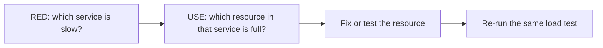

<TLDR>
A bottleneck is the one thing that limits how much work a system can do. Use the USE method to check each resource (CPU, memory, disk, network, pools). Use the RED method to check each service (rate, errors, duration). RED shows which service hurts. USE shows which resource in that service is full.
</TLDR>

## What and why

When a load test gets slow, many graphs move at once. Without a method, people guess. The guess is often "add more servers", which may not help.

**USE** comes from Brendan Gregg's method. For every resource, check three things:

- **Utilisation:** how busy it is.
- **Saturation:** how much work is waiting for it.
- **Errors:** how often it fails.

**RED** comes from the Grafana team's service approach. For every service, check:

- **Rate:** requests per second.
- **Errors:** the share of requests that fail.
- **Duration:** how long requests take.

| Method | Applies to | Check |
|---|---|---|
| USE | Resources: CPU, memory, disks, network, connection pools, thread pools | Utilisation, saturation, errors |
| RED | Services and endpoints | Rate, errors, duration |

## How it works

Use RED first, because it points to a service quickly. Then use USE inside that service. Saturation is the key signal. A pool at 100% utilisation with requests waiting is a bottleneck. A CPU at 40% with requests waiting for I/O is not a CPU problem.

## When to use it (and when not to)

| Use it when | Skip it when |
|---|---|
| A load test shows rising latency and you need the cause | Everything is fast and within SLO |
| You have metrics for each service and resource | You have no metrics at all. Add basic metrics first |
| Several teams argue about the cause | The problem is clearly a single slow query. Start with the database chapter |

## TaskFlow example

:::info[Illustrative data]
This is a made-up story for a production-style TaskFlow setup, where `task-service` runs on several containers. The numbers are for teaching only.

During a load step to 50 requests per second:

- **RED on task-service:** rate is steady, error rate stays at 0.1%, and p95 duration rises from 120 ms to 900 ms.
- **USE on task-service:** CPU is at 35%. The database connection pool is at 100% utilisation, with requests waiting for a free connection.

Conclusion: the limit is the connection pool, not CPU. Adding more task containers would add more pools that all hit the same database. See [database performance](/performance-by-layer/database-performance).
:::

The local TaskFlow runs as one process, so the same checks apply to one service. CPU, memory and the SQLite or Postgres connection are the resources to watch.

## Do this

- Start with RED to find the service, then USE to find the resource.
- Use the same time window for all graphs. Mismatched windows cause wrong conclusions.
- Check saturation, not just utilisation.
- Check the load generator as well (see [distributed load and dashboards](/load-testing-tools/distributed-load-and-dashboards)). A busy generator makes the target look slow.
- Save screenshots or exports of the graphs with the test results.

## Avoid this

- Concluding "CPU is low, so it is fine" when requests are waiting on something else.
- Changing two things at once. You cannot tell which one helped.
- Adding capacity before you know which resource is full.

## Further reading

- [The USE Method](https://www.brendangregg.com/usemethod.html), Brendan Gregg.
- [The RED Method: how to instrument your services](https://grafana.com/blog/the-red-method-how-to-instrument-your-services/), Grafana Labs blog.
