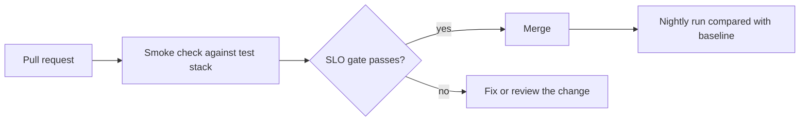

<TLDR>
Performance problems creep in one change at a time. Run a small, fast check on every pull request, a longer test on a schedule, and a full test before release. Compare each run with a baseline and fail the build when an SLO breaks.
</TLDR>

## What and why

A **performance regression** is a slowdown that a later change caused. Nobody notices one small slowdown. After twenty changes, the system is slow and nobody knows why.

A strategy decides three things for each test: how often it runs, how much load it puts on the system, and what result fails the build.

## How it works

Recommendation: use three tiers.

| Tier | When it runs | Load | Pass rule |
|---|---|---|---|
| **Pull request check** | Every pull request | 1 to 2 minutes, a few users, a test deployment | The SLO gate passes (p95 and error rate) |
| **Nightly run** | Every night | 15 to 30 minutes, using the workload profile | Compared with the baseline. Alert on large changes |
| **Pre-release test** | Before a release | Full profile, plus a soak run | A person reviews the report and signs off |

Shared CI machines are noisy. One slow run is not proof of a regression. Use a generous threshold for the pull request check, and look at trends across nightly runs.

## When to use it (and when not to)

| Use it when | Skip it when |
|---|---|
| The service handles real traffic and has an SLO | A prototype with no users. Keep the smoke check only |
| Changes often touch hot paths, such as queries or serialisation | The team has no baseline yet. Record one first |
| Releases happen often | Releases are rare and a full test already runs before each one |

## TaskFlow example

The pull request check can reuse the local tools in this handbook:

- Start the API in the CI job, for example with `uvicorn app.main:app --port 8000`.
- Run the Locust SLO gate: `pytest -q loadtest/test_slo_gate.py`. It fails when p95 or the error rate breaks its threshold. See [Hands-on: Locust with pytest](/load-testing-tools/locust-with-pytest).
- Or run the k6 smoke script. k6 marks the run as failed when a threshold breaks. See [Hands-on: k6](/load-testing-tools/k6).
- Save the CSV or JSON output as a job artifact, so the nightly job can compare trends.

For job setup, see [CI/CD and continuous testing](/automation-engineering/ci-cd-and-continuous-testing).

## Do this

- Keep the pull request check short and deterministic. Same data, same script, same users.
- Store every result as an artifact. Trends need history.
- Put threshold changes through code review, like any other change.
- Retry a failed smoke check once. If it fails again, investigate. Do not keep retrying. (Flaky checks are covered in [flaky tests](/automation-engineering/flaky-tests).)
- Run the full test on a stack that looks like production, and say what differs.

## Avoid this

- Running a long, heavy load test on every pull request.
- Treating one noisy run as proof of a regression, or of a fix.
- Pointing CI at a shared staging system without telling the team.
- Loosening a threshold just to make the build green, without a reason.
