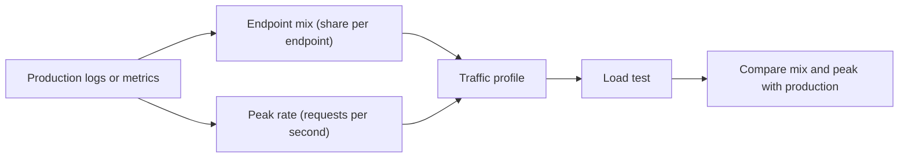

<TLDR>
A workload model describes what real users do: which endpoints they call, how often, and how many are active at the same time. Build it from production logs or metrics, not from guesses. Then turn it into a load profile and check that the profile matches production.
</TLDR>

## What and why

A load test that calls one endpoint over and over tests that endpoint. It says little about the system. Real traffic has a mix. Some calls read, some write, and the volume rises and falls over the day.

A **workload model** is the description of that mix and shape. A **traffic profile** is the same model written as numbers a load tool can run: an arrival rate over time, plus the share of each request type.

Start from data you already have. Access logs, API gateway metrics or application traces can show the endpoints, counts and times. Log only aggregated counts. Do not copy personal data into a test.

## How it works

The steps:

1. **Collect** at least one normal week, including a peak. Filter out health checks and bots.
2. **Normalise** the URLs. Replace IDs with templates, so `/api/tasks/812` becomes `/api/tasks/{id}`.
3. **Count the mix.** Work out each endpoint's share of all requests.
4. **Measure the rate.** Find the average and the peak requests per second. Note the peak-to-average ratio.
5. **Add user behaviour.** Estimate requests per session and the think time (the pause between requests).
6. **Build the profile** and **validate** it. The simulated mix and peak should match production within a margin you agree on.

:::info[Illustrative data]
This is a made-up daily summary for TaskFlow. The numbers are for teaching only.

| Endpoint | Requests per day | Share |
|---|---|---|
| `GET /api/tasks` | 540,000 | 60% |
| `GET /api/tasks/{id}` | 225,000 | 25% |
| `POST /api/tasks` | 81,000 | 9% |
| `PUT /api/tasks/{id}` | 36,000 | 4% |
| `POST /api/auth/login` | 18,000 | 2% |

Total: 900,000 requests a day, about 10.4 per second on average. Peak minute: 1,800 requests, which is 30 per second. The peak-to-average ratio is about 2.9.
:::

## When to use it (and when not to)

| Use it when | Skip it when |
|---|---|
| You are about to run a load, soak or spike test | You only run a smoke check, which needs no mix |
| The API has several endpoints with different costs | There is one endpoint and one known rate |
| Production traffic has a clear daily or weekly shape | The product is new and there is no data. Use a stated assumption and label it |

## TaskFlow example

The local Locust script weights its tasks 5, 3 and 1 for list, create-and-read and move. Those weights are a starting guess. They are not derived from data.

The illustrative summary above shows the real idea. Reads dominate (85%), writes are small (13%), and login is rare (2%) because each user logs in once per session. A profile for TaskFlow would:

- Give `GET /api/tasks` and `GET /api/tasks/{id}` most of the weight.
- Keep writes at their observed share, so the database sees realistic load.
- Let login happen at session start, not in every loop.
- Ramp to the observed peak rate, then hold it.

Once you have real numbers, change the weights in `examples/taskflow/loadtest/locustfile.py` to match. Do not change them for this chapter.

## Do this

- Use at least a week of data that includes a peak.
- Keep the mix (shares) and the rate (requests per second) as separate settings.
- Write down every assumption, and label any estimate as an estimate.
- Re-model after a big release or a change in user behaviour.
- Compare the simulated mix with production before you trust the results.

## Avoid this

- Modelling from the average alone. Averages hide the peak.
- Leaving out writes, background jobs or the login flow.
- Copying personal data, session IDs or user names into test files.
