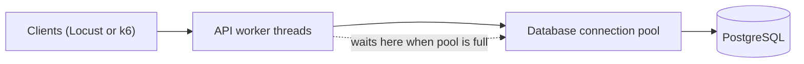

<TLDR>
API response time often rises because requests wait: for a free worker thread, a free database connection, a lock, or a slow downstream call. The CPU can be low while this happens. Test with realistic concurrency, and watch pools and memory alongside response time.
</TLDR>

## What and why

Most APIs have fixed-size resources. Each one can run out:

- **Worker or thread pool:** the number of requests the server handles at once.
- **Database connection pool:** the number of open database connections. Each query needs one.
- **Memory:** a cache, dictionary or list that only grows.
- **File descriptors and sockets:** the operating system's limit on open network connections.
- **Downstream calls:** another service or API that has its own limit.

When a resource is full, new requests queue. The queue adds latency, but nothing is broken. That is why a load test can show slow responses with low CPU.

## How it works

Symptoms and their likely causes:

| What you see | Likely cause to check first |
|---|---|
| Latency rises, CPU stays low | Waiting for a pool, a lock or a downstream call |
| Memory rises steadily over time | A leak, or a cache with no size limit |
| Errors appear after minutes of load | A resource runs out, such as connections or file handles |
| Many 429 responses | A rate limit is working as designed. Check the limit is right |

## When to use it (and when not to)

| Use it when | Skip it when |
|---|---|
| An API slows down as concurrency rises | You are testing a single user's correctness. Use [API testing](/testing-by-layer/api-testing) |
| You plan to change pool sizes or thread counts | The API is a static file server with no state |
| A soak test shows memory growth | The run is too short to show growth |

## TaskFlow example

The local API in `examples/taskflow/app/main.py` shows the idea in a small way.

- Every database request opens a session with `get_db()`. SQLAlchemy manages a connection pool behind the engine.
- Login stores each new token in the `TOKENS` dictionary. Nothing removes old tokens. Each login adds one entry for as long as the process runs.

The locust script logs in once per simulated user. So a long test with users that keep arriving will grow `TOKENS`. A soak test with memory tracking will show the growth. This is a demo app, and the in-memory store is a known simplification. In a real service you would set token expiry and a size limit. For the soak method, see [soak tests and memory leaks](/ecs-performance/soak-tests-and-memory-leaks).

To see pool waiting, run the same load at two concurrency levels and compare latency with the pool size. Record what you see with the same time window for every graph.

## Do this

- Test with the concurrency your users create, not one request at a time.
- Watch pool use, thread use and memory during every load test.
- Set a timeout for waiting on a pool. A request that waits forever hides the problem.
- Check that a pool size does not exceed the database's connection limit.
- Run a soak test before you trust a memory result.

## Avoid this

- Adding threads or connections without checking the database limit.
- Judging an API only by response time, with no look at its resources.
- Testing only with one virtual user, which never fills a pool.

## Further reading

Start with the [database performance](/performance-by-layer/database-performance) chapter for pool and query details. For resource checks, see [finding bottlenecks](/performance-fundamentals/finding-bottlenecks).
