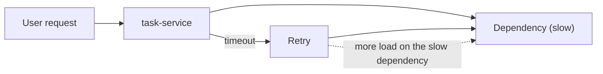

<TLDR>
In a system of many services, one slow service slows every caller. Test the whole chain, not each service alone. Watch queues and retries, because retries can turn a slow dependency into an outage.
</TLDR>

## What and why

A single user action can touch several services. Each hop adds latency. If `task-service` waits on another service, its response time includes that wait.

Three effects matter most:

- **Latency adds up.** Five calls at 100 ms each take at least 500 ms, before any work is done.
- **Cascading failure.** A slow service holds threads and connections. Its callers then run out of threads and slow down too.
- **Retry storm.** Callers retry timeouts. The extra requests overload the slow service, which slows more, which causes more retries.

Event-driven parts add a fourth effect. A slow consumer does not slow the producer's response. Instead, a queue grows. Requests still succeed, but the work is late.

## How it works

Measure these for every service in the chain:

| Measure | Why |
|---|---|
| Duration by service (RED) | Shows which hop adds time. See [finding bottlenecks](/performance-fundamentals/finding-bottlenecks) |
| Timeouts and retries | A rising retry count often comes before an outage |
| Queue depth and oldest message age | Shows a growing backlog for async work |
| Traces across services | Shows where time goes inside one request. See [observability for testers](/modern-quality-engineering/observability-for-testers) |

## When to use it (and when not to)

| Use it when | Skip it when |
|---|---|
| A user action crosses two or more services | One service with no outgoing calls |
| Events feed a background consumer | Everything is one process |
| You want to know what a slow dependency does to users | You only need the single service's capacity |

## TaskFlow example

The reference architecture uses `task.assigned` and `task.status_changed` events, sent through SNS and SQS to `notification-service`. The local TaskFlow has no SNS, SQS or notification service, so this example is a production-style design.

A load test for this path would:

1. Create and update tasks at a steady rate, using the same mix as the workload model.
2. Measure p95 latency for the request. It should stay flat if the queue is healthy.
3. Measure the age of the oldest message in the notification queue. It should not keep growing.
4. Slow `notification-service` on purpose, in a test environment. Watch whether `task-service` latency changes. If it does, a synchronous link is hidden in the path.

:::info[Illustrative data]
A healthy run keeps queue age near zero. A slow consumer makes the queue age rise minute by minute, while the API still returns 200 OK. Only the queue metric shows the problem. The numbers would come from your own test, not from this page.
:::

## Do this

- Test the whole chain, with real or realistic dependencies.
- Set timeouts and a retry limit with backoff and jitter for every call.
- Watch queue age and depth as a main measure for async work.
- Test a slow or failing dependency on purpose (see [reliability and chaos](/other-non-functional/reliability-and-chaos)).
- Use traces to find the hop that adds time.

## Avoid this

- Load-testing one service while its dependencies are mocked to answer instantly. That hides the cascade.
- Unlimited retries.
- Calling an event flow healthy just because the API returns success.

## Further reading

For event tests, idempotency and ordering, see [microservices and event-driven testing](/testing-by-layer/microservices-and-event-driven-testing).
