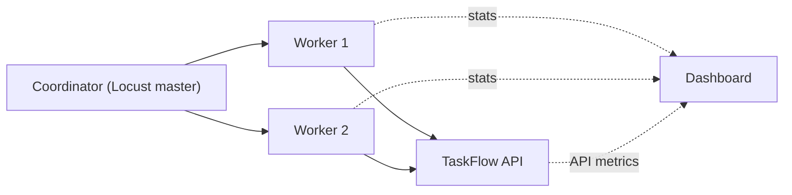

<TLDR>
One machine can only send so much traffic. Split the load across several generator machines, and send the results to a dashboard. Always watch the generator's own CPU. A busy generator makes the system look slower than it is, so its numbers cannot be trusted.
</TLDR>

## What and why

A **load generator** is the machine running the load tool. Distributed load means several generators sending traffic at the same time, with one coordinator that starts, stops and collects results.

A **dashboard** shows results over time. Many teams send load-test metrics to a time-series database, then draw graphs in Grafana. Examples of time-series databases are InfluxDB and Prometheus. Pick one your team already runs.

Distributed setups add more places where things can go wrong: network limits, clock drift between machines, and generators that compete for the same resources.

## How it works

Each tool has its own distributed model. These are the ones checked for this chapter:

- **Locust:** one **master** runs the web UI or headless run and tells the workers what to do. **Workers** run the simulated users and send statistics back. Run one worker per CPU core, because Python's GIL limits each process to about one core.
- **k6:** the open-source version runs a single instance. Distributed runs use the **k6-operator** on Kubernetes, which splits the work into several test jobs.
- **JMeter:** a client machine controls remote **engines**. Each engine runs the full plan and returns its results.
- **Gatling and Artillery:** see [choosing a tool](/load-testing-tools/choosing-a-tool) for what the docs say.



Put these on one dashboard, on the same time axis:

| Panel | Why |
|---|---|
| Requests per second, by endpoint | Confirms the load you intended was sent |
| p95 latency, by endpoint | The main result |
| Error rate | A fast error is still a failure |
| Active users | Shows the ramp and the plateau |
| **Load generator CPU and memory** | Shows whether the generator is the bottleneck |
| Target CPU, memory and pool use | Shows where the system is stressed |

## When to use it (and when not to)

| Use it when | Skip it when |
|---|---|
| One machine cannot produce the rate you need | One machine is enough for the rate. Keep the setup simple |
| You need a graph of the test next to system metrics | You only need the summary the tool prints |
| Load comes from more than one region | All traffic comes from one office. Use one generator |

## TaskFlow example

On one laptop, the coordinator, the workers, the API and the dashboard all share one CPU. Results from that setup measure the laptop. Use it only to learn the commands.

Locust commands from its docs, for a local learning run:

```bash
# Coordinator: waits for 2 workers, then runs headless for 5 minutes
locust -f loadtest/locustfile.py --master --host http://localhost:8000 \
       --headless -u 50 -r 5 -t 5m --expect-workers 2

# In two more terminals: one worker each
locust -f loadtest/locustfile.py --worker --master-host 127.0.0.1
```

:::info[Illustrative data]
A made-up example of why the generator matters. A generator at 95% CPU reports a p95 of 800 ms for `GET /api/tasks`. The API's own metrics show a p95 of 150 ms over the same window. The generator was the slow part. The fix is more generators, not a slower API.
:::

These commands were not run as part of this handbook's checks.

## Do this

- Watch the generator's CPU, memory and network on the same dashboard as the target. Stop a run when a generator is saturated.
- Recommendation: keep each generator clearly below full CPU. Add generators before you add users to a busy one.
- Put generators in the same region as the target, or near it, so network time does not hide in the results.
- Give every run a name and a time window. Compare runs by window, not by memory.
- Keep the raw CSV or JSON from each run, so results can be checked later.

## Avoid this

- Running the coordinator, workers and the API on one laptop, and calling the result a measurement.
- Trusting a graph that does not show the generator's own resources.
- Mixing results from two runs on one panel without a label.

## Further reading

- [Running Locust distributed](https://docs.locust.io/en/stable/running-distributed.html), Locust docs. Checked as of 2026-11-06.
- [Run distributed tests](https://grafana.com/docs/k6/latest/testing-guides/running-distributed-tests/), Grafana k6 docs.
- For an AWS version of this setup, see [running a load test against ECS safely](/ecs-performance/running-a-load-test-on-ecs).
