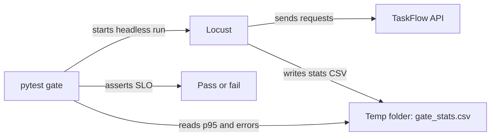

<TLDR>
Locust sends the load. pytest does not send any traffic. It reads the CSV results that Locust writes, and it fails when p95 or the error rate breaks an SLO. The example runs against the local TaskFlow API in `examples/taskflow/`.
</TLDR>

## What and why

Locust is a load tool written in Python. You describe a user's behaviour as Python tasks, and Locust runs many simulated users at once. See the [Locust repository](https://github.com/locustio/locust) (MIT licence).

pytest is a test runner. On its own it checks results. Put the two together and each does one job:

- **Locust** generates the load and records each request.
- **pytest** reads the results and asserts the thresholds.

This keeps the load script a plain Locust file, and the pass or fail rule a plain pytest test. CI can run both in one step.

## How it works



The gate does four things:

1. Checks that a server answers at `/health`. If not, every test is skipped.
2. Runs `locust --headless` against the URL, with `--csv` for results.
3. Reads the `Aggregated` row of the `_stats.csv` file.
4. Asserts that the 95th percentile is at or below `SLO_P95_MS`, and that the error rate is at or below `SLO_ERROR_RATE`.

The files are `examples/taskflow/loadtest/locustfile.py` (the existing load script) and `examples/taskflow/loadtest/test_slo_gate.py` (the new gate). The assertions are the core of the gate:

```python
def test_p95_within_slo(aggregated_stats):
    p95_ms = float(aggregated_stats["95%"])
    assert p95_ms <= SLO_P95_MS, f"p95 {p95_ms:.0f} ms is above the {SLO_P95_MS:.0f} ms SLO"


def test_error_rate_within_slo(aggregated_stats):
    requests = int(aggregated_stats["Request Count"])
    failures = int(aggregated_stats["Failure Count"])
    assert requests > 0, "Locust sent no requests"
    error_rate = failures / requests
    assert error_rate <= SLO_ERROR_RATE, (
        f"error rate {error_rate:.2%} is above the {SLO_ERROR_RATE:.2%} SLO "
        f"({failures} of {requests} requests failed)"
    )
```

## When to use it (and when not to)

| Use it when | Skip it when |
|---|---|
| Your team already writes pytest and wants one CI step | You need a browser or a GUI-driven test. Use [end-to-end testing](/testing-by-layer/end-to-end-testing) |
| You want thresholds in version control, next to the load script | You need per-endpoint thresholds in the test tool itself. Consider [k6](/load-testing-tools/k6) |
| You run a short smoke gate on each change | You need a long soak run on one gate. Run Locust directly and read its report |

## TaskFlow example

Use three terminals, or run the server in the background. From `examples/taskflow`, with the existing `.venv`:

```bash
# 1. Start the API
.venv/bin/uvicorn app.main:app --port 8000

# 2. Run the gate (30 seconds, 10 users by default)
.venv/bin/python -m pytest -q -rs loadtest/test_slo_gate.py

# 3. Stop the API (Ctrl+C in its terminal)
```

Settings come from environment variables: `TASKFLOW_URL`, `SLO_P95_MS` (default 500), `SLO_ERROR_RATE` (default 0.01), `GATE_USERS`, `GATE_SPAWN_RATE` and `GATE_RUN_TIME`.

What we ran for this chapter, on 2026-11-06, on a local development machine:

- With no server running, both tests were **skipped**.
- With the server running, both tests **passed**, after a 30-second run.
- With `SLO_P95_MS=1`, the p95 test **failed**, as expected: `p95 11 ms is above the 1 ms SLO`. This shows the gate can fail.

These are pass and fail checks from a laptop, not a performance result. Do not quote them as TaskFlow's speed.

:::warning
`pytest -q` from `examples/taskflow` also finds this file. When no server is running it skips. When a server is running, it starts a 30-second load run. Point `pytest` at `tests/` when you only want the API tests.
:::

## Do this

- Keep the load script and the gate in the same folder, and version them together.
- Start with a short smoke run. Only raise the duration after the basics pass.
- Read the `Aggregated` row for the whole test. Read the endpoint rows when a threshold fails.
- Set thresholds from your SLOs, and pass them in as environment variables for each environment.
- Run the gate against a test stack, never against production.

## Avoid this

- Asserting on a run of a few seconds. The numbers are too noisy to trust.
- Setting thresholds so loose that the gate can never fail. Try the negative check above.
- Letting pytest's default discovery start load in an unrelated test run.
