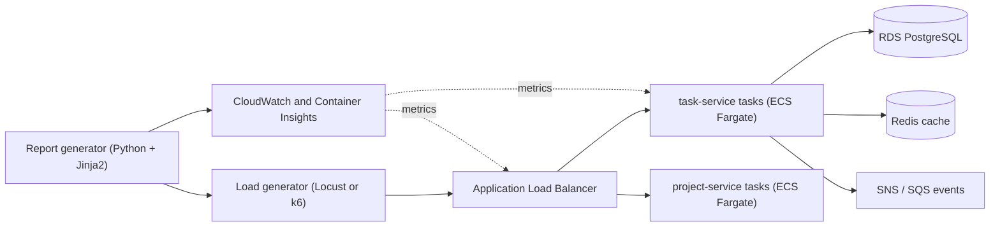

<TLDR>
TaskFlow runs on AWS ECS with Fargate, so each service is a group of containers called tasks. A load test hits the load balancer, which spreads requests across the tasks, and the tasks call the database. Latency can come from any hop, so test the whole path, not one container.
</TLDR>

## What and why

ECS (Elastic Container Service) runs containers on AWS. Fargate runs them without you managing servers. Four terms matter here:

- **Task:** one running copy of a container.
- **Service:** a group of identical tasks that ECS keeps running. `task-service` is one service.
- **Task definition:** the recipe for a task: image, CPU, memory.
- **Task size:** the CPU and memory fixed for each task.

The problem is that a slow response can come from any layer. Adding tasks helps only when the tasks are the bottleneck. This chapter maps the path, so the later chapters know what to measure.

## How it works

1. The load generator sends HTTP requests. See [Locust with pytest](/load-testing-tools/locust-with-pytest) and [k6](/load-testing-tools/k6).
2. The ALB picks a healthy task from the target group and forwards the request.
3. The task runs the service code. It may call RDS, Redis or publish an event.
4. CloudWatch collects metrics from the ALB and the tasks. A report combines them with the load-test results.

Each task has a fixed size. As of 2026-11-06, the AWS docs list these valid Fargate combinations for Linux (Windows has fewer):

| CPU | Memory (valid values) |
|---|---|
| 0.25 vCPU (256) | 512 MiB, 1 GB, 2 GB |
| 0.5 vCPU (512) | 1 GB to 4 GB |
| 1 vCPU (1024) | 2 GB to 8 GB |
| 2 vCPU (2048) | 4 GB to 16 GB, in 1 GB steps |
| 4 vCPU (4096) | 8 GB to 30 GB, in 1 GB steps |
| 8 vCPU (8192) | 16 GB to 60 GB, in 4 GB steps |

Larger sizes (16 and 32 vCPU) also exist. Pick only a pair from the table. Any other pair is rejected at registration with an "Invalid 'cpu' setting" error.

## When to use it (and when not to)

| Use this map when | Skip it when |
|---|---|
| You plan a load test on AWS and need to know which parts to watch | You are testing one endpoint on your laptop. Use the [Locust chapter](/load-testing-tools/locust-with-pytest) |
| Latency rises and you do not know which layer is slow | You only need the SLO definition. See [performance requirements and SLOs](/performance-fundamentals/performance-requirements-and-slos) |

## TaskFlow example

`task-service` runs as an ECS service on Fargate, behind the ALB, and it uses one RDS PostgreSQL database. In the illustrative test in [The performance report](/ecs-performance/performance-report), it ran six tasks of 1 vCPU and 2 GB each. The pair 1024 CPU with 2048 MiB is valid.

:::info[Illustrative data]
The task count and size in this example are invented for the handbook. Nothing was run on a real AWS account.
:::

The local TaskFlow in `examples/taskflow/` has no ECS, ALB or RDS. It runs on localhost, so use it to learn the tools, not to learn ECS behaviour.

## Do this

- Draw the request path before you test. Write down every hop and every shared dependency.
- Run the load generator in the same AWS region as the ALB. Recommendation: this keeps internet latency out of your numbers. AWS also advises keeping AWS-hosted endpoints in the local region ([AWS testing policy](https://aws.amazon.com/ec2/testing/), as of 2026-11-06).
- Pick task sizes only from the valid table.
- Record which services share the database. A slow shared database slows all of them.

## Avoid this

- Assuming more tasks always means more speed. Tasks share the database and the cache.
- Calling a result "service capacity" when the database was also under load.

## Further reading

- [AWS: Fargate task CPU and memory combinations](https://docs.aws.amazon.com/AmazonECS/latest/developerguide/task-cpu-memory-error.html) (checked 2026-11-06)
- [AWS: Container Insights metrics for ECS](https://docs.aws.amazon.com/AmazonCloudWatch/latest/monitoring/Container-Insights-metrics-ECS.html) (checked 2026-11-06)
