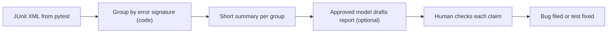

<TLDR>
When a CI run fails, most of the work is sorting failures into groups and finding the first real error. Do the grouping with plain code, which is repeatable. Use an approved model only to draft the write-up, and have a person check it before a bug is filed.
</TLDR>

## What and why

Triage means deciding what a failure is, who should look at it, and whether it is a real bug. A run with 40 failures is often 3 problems. A model can help read long logs. The risk is that it invents a cause that the logs do not show.

Split the work in two:

1. **Group the failures with code.** The same error text gives the same groups every time. You can test this step.
2. **Draft the bug report with a model, if your data policy allows it.** Check every claim against the logs.

## How it works



Pytest can write a JUnit XML report with `pytest --junitxml=report.xml`. Most CI systems read this format.

## TaskFlow example: group failures without AI

The script below reads a JUnit XML file and groups failures by the first line of their message. It replaces numbers with `N`, so `task 12` and `task 37` land in the same group. It uses only the Python standard library.

```python
import re, sys
import xml.etree.ElementTree as ET
from collections import defaultdict

def signatures(path):
    groups = defaultdict(list)
    for case in ET.parse(path).getroot().iter("testcase"):
        for fail in case.findall("failure") + case.findall("error"):
            first = (fail.get("message") or "").strip().split("\n")[0]
            key = re.sub(r"\d+", "N", first)[:120]
            groups[key].append(f"{case.get('classname')}::{case.get('name')}")
    return groups

if __name__ == "__main__":
    for sig, tests in sorted(signatures(sys.argv[1]).items(), key=lambda kv: -len(kv[1])):
        print(f"{len(tests):>3}  {sig}")
        for t in tests[:3]:
            print(f"       {t}")
```

Run it on a report: `python3 summarise.py report.xml`. Use a sample file to test it first. The output shows one line per error type, with a count. That is the input a human, or an approved model, should read first.

:::info[Illustrative data]
A failure report from a made-up run might show "4 tests fail with `Expected 201, got 422`". The numbers are examples, not measurements of TaskFlow.
:::

## When to use it (and when not to)

| Use it when | Skip it when |
|---|---|
| A run has many failures that repeat | There is one failure with a clear stack trace |
| The logs are long and hard to scan | The logs contain secrets or personal data and no approved model exists |
| A person checks every draft | The draft would be filed automatically |

## Do this

- Group failures with code first. Keep that step under test.
- Send a model only the grouped summary and the first failing trace, never full logs with secrets.
- Check every claim in a draft against the log line it cites.
- Link each group to a flaky-test check if the same test fails and passes across runs ([Flaky tests](/automation-engineering/flaky-tests)).
- Store the draft and its source logs, so you can see later what the model saw.

## Avoid this

- Filing bugs straight from a model's output.
- Letting a model guess the root cause without the trace that supports it.
- Sending customer data or tokens to a model you have not approved.

## Further reading

- [CI/CD and continuous testing](/automation-engineering/ci-cd-and-continuous-testing) for where triage fits in a pipeline.
- [Reporting and logging](/automation-engineering/reporting-and-logging) for how to keep the JUnit XML and logs.
