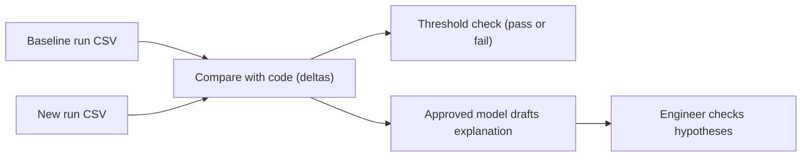

<TLDR>
A performance regression is a change in numbers between two runs. Compute the change with code, using the same percentile and the same workload. A model can then help explain the change in plain words, using the numbers you pass it. It must not decide pass or fail.
</TLDR>

## What and why

A load test run produces many numbers: p50, p95, p99, requests per second, error rate, and more ([Performance metrics](/performance-fundamentals/performance-metrics) explains them). A regression is when the new run is worse than a baseline. Finding it is simple. Explaining it is harder. Which change caused it? Was it the code, the data, or the load generator?

AI can help with the explaining. It cannot replace the measurement. Keep these two jobs apart:

- **Measure:** code computes the deltas. Same tool, same workload, same percentile. This step is repeatable.
- **Explain:** a model reads the deltas and the change list, and drafts hypotheses. A human checks each one against traces, metrics and the code.

## How it works



The pass or fail decision comes from the threshold check, not from the model.

## TaskFlow example: compare two Locust runs

The TaskFlow load script is in `examples/taskflow/loadtest/locustfile.py`. The README in that folder shows a smoke run that writes CSV files:

```bash
locust -f loadtest/locustfile.py --host http://localhost:8000 --headless -u 10 -r 2 -t 1m --csv results/smoke
```

Locust writes `results/smoke_stats.csv`. Its `Aggregated` row holds totals for the whole run. The script below compares one percentile column between a baseline and a new run. It assumes a column named `95%`. Check the header in your own file, because column names can change between versions.

```python
import csv, sys

def aggregated(path, column):
    with open(path, newline="") as f:
        for row in csv.DictReader(f):
            if row["Name"] == "Aggregated":
                return float(row[column])
    raise SystemExit(f"No Aggregated row in {path}")

if __name__ == "__main__":
    base, new = sys.argv[1], sys.argv[2]
    column = sys.argv[3] if len(sys.argv) > 3 else "95%"
    before, after = aggregated(base, column), aggregated(new, column)
    change = (after - before) / before * 100
    print(f"{column}: {before:.0f} ms -> {after:.0f} ms ({change:+.1f}%)")
```

:::info[Illustrative data]
The two files below are made-up numbers for this example. They are not measurements of TaskFlow.

| Run | p95 (ms) | p50 (ms) | Requests |
|---|---|---|---|
| Baseline | 180 | 45 | 500 |
| Candidate | 310 | 48 | 500 |

The script prints `95%: 180 ms -> 310 ms (+72.2%)`.
:::

Now the explanation step. Give a model only the table above, the change list (for example, "added a new query to the task list"), and the error counts. Do not give it secrets or customer data. Ask it for hypotheses, not verdicts. A good hypothesis here is "the p95 rose but the p50 barely moved, so a slow tail is likely. Check the database connection pool and the traces for the slow requests." The engineer then checks the traces and the pool metrics. [Finding bottlenecks (USE and RED)](/performance-fundamentals/finding-bottlenecks) explains the method.

## When to use it (and when not to)

| Use it when | Skip it when |
|---|---|
| A new run needs a quick comparison with a baseline | The workload differs between runs, so the numbers are not comparable |
| You want a first draft of hypotheses to test | The model would be the only source of a conclusion |
| The data can be shared with an approved model | The data contains secrets or customer data |

## Do this

- Compare only runs with the same workload, duration, data and load generator.
- Use a fixed percentile (for example p95) in the threshold check, written in code.
- Give the model the deltas and the change list, and ask it to list what would disprove each hypothesis.
- Check each hypothesis against a trace, a metric or the code before you act on it.
- Keep the model's text in the report as a draft, with the numbers it used.

## Avoid this

- Asking a model "did this pass?" and trusting the answer.
- Comparing a run on a laptop with a run in a test environment.
- Quoting a model's guess about a root cause as a finding.

:::warning[Recommendation, not a standard]
Treat the model's explanation as a lead. The performance report in [The performance report](/ecs-performance/performance-report) has a place for evidence and for what was not tested.
:::

## Further reading

- [Locust repository](https://github.com/locustio/locust). MIT licence, latest release 2.47.0 (2026-10-21), as of 2026-11-06. The `--csv` option is described in its configuration docs.
