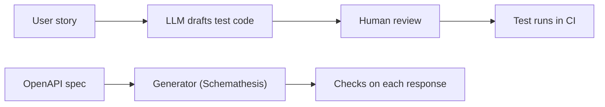

<TLDR>
Test generation comes in two kinds. An LLM can write test code from a plain-English story. A spec-based generator such as Schemathesis reads an OpenAPI file and produces many API inputs with no model. Both need human review. A generated test is only useful when its assertions check a real business rule.
</TLDR>

## What and why

Writing tests takes time. AI tools can draft them fast. The risk is that a draft test looks right but checks the wrong thing, for example by asserting whatever the app does today.

Two different approaches solve different problems:

- **AI test writing:** input is a user story, output is test code, for example a Playwright test. The model guesses intent from words.
- **Spec-based generation:** input is an OpenAPI file (a machine-readable description of an API). Output is many generated requests. The tool does not guess intent. It follows the schema and checks the responses against it.

## How it works



The top path depends on a model, so its output can change between runs. The bottom path is repeatable: the same spec and the same seed give the same requests.

## TaskFlow OpenAPI spec

The running TaskFlow app serves its spec at `http://localhost:8000/openapi.json`. Start the app first (see [the TaskFlow reference](/start-here/taskflow-reference)). The spec lists six paths: login, projects, tasks, one task, assign, and health.

To save the spec to a file without starting the server, run this from `examples/taskflow/`. The README in that folder has the same command.

```bash
.venv/bin/python -c "import json; from app.main import app; print(json.dumps(app.openapi(), indent=2))" > /tmp/taskflow-openapi.json
```

## Compare the two approaches

| Question | AI test writing (Playwright) | Schemathesis (non-AI) |
|---|---|---|
| Input | A user story in plain English | An OpenAPI file |
| Output | Readable test code | Generated API requests and response checks |
| Same input, same output? | Not guaranteed | Yes, for the same spec and seed |
| Needs a paid model key? | Usually yes | No |
| Knows the business rule? | Only if the story says it | Only the schema rules, plus checks you add |
| Good at | Full user flows, readable tests | Schema drift, 500 errors, input edge cases |
| Weak at | Hidden rules, repeatability | Business logic such as "only members can assign" |

EvoMaster is another spec-based option. Its repo calls it an AI-driven tool. We did not check its technique in detail, so do not rely on that label.

Run Schemathesis against TaskFlow (CLI syntax from its docs, checked 2026-11-06):

```bash
st run http://localhost:8000/openapi.json --checks all
```

## TaskFlow example: a rule-based test

Business rule: a title is 1 to 100 characters. The existing suite already tests the boundaries (`test_task_title_length_boundaries` in `examples/taskflow/tests/`). A generated Playwright API test should check the same rule with fixed values. This sketch is not run in this handbook. It needs the `pytest-playwright` plugin.

```python
import pytest

@pytest.fixture
def api(playwright):
    ctx = playwright.request.new_context(base_url="http://localhost:8000")
    yield ctx
    ctx.dispose()

def login(api):
    r = api.post("/api/auth/login", data={"username": "alice", "password": "alice-pass"})
    return r.json()["token"]

def test_101_character_title_is_rejected(api):
    auth = {"Authorization": f"Bearer {login(api)}"}
    r = api.post("/api/tasks", data={"title": "a" * 101, "priority": "LOW", "project_id": 1}, headers=auth)
    assert r.status == 422
```

Checked locally: the app returns 201 for a 100-character title and 422 for 101. The assertion is fixed, so it gives the same result every run.

## Human review checklist

Before any generated test joins the suite:

- Does each assertion check a rule from the spec or the story, not just today's output?
- Are the test values fixed, not random or model-chosen?
- Does it fail when you break the rule on purpose? Try this once.
- Does it run three times in a row with the same result?
- Is the code readable enough that the next person can change it?

## When to use it (and when not to)

| Use AI test writing when | Use spec-based generation when | Skip both when |
|---|---|---|
| A story exists and no tests do yet | An OpenAPI spec exists and is accurate | The rule is complex and no one has written it down |
| A reviewer will read every line | You want broad input coverage cheaply | You need exact expected output for money or compliance |

## Do this

- Write the business rule in the story before you ask a model for tests.
- Keep AI-written tests in a separate folder until a reviewer has signed off.
- Use spec-based generation to find crashes and schema drift, then add rule checks by hand.
- Record the model name and version used for any generated test.

## Avoid this

- Accepting generated assertions such as `assert response.json() == <whatever came back>`. That locks in bugs.
- Running generated tests without reading them.
- Treating a passing generated test as proof that the rule holds.

## Further reading

- [Schemathesis documentation](https://schemathesis.readthedocs.io/en/stable/). Describes the CLI and checks. Fetched 2026-11-06.
- [Playwright repository](https://github.com/microsoft/playwright). Apache-2.0, latest release v1.65.0 (2026-11-05), as of 2026-11-06.
