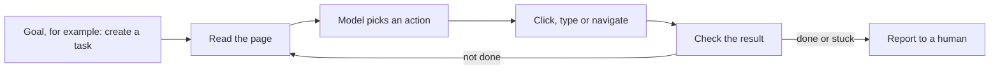

<TLDR>
A browser agent is a model that clicks, types and reads a page to reach a goal. It can explore an app faster than a person can script it. Its path changes from run to run, so treat its output as leads for human testers. Turn each confirmed finding into a fixed test with deterministic assertions.
</TLDR>

## What and why

Scripted UI tests check the paths you wrote down. Exploratory testing finds the paths nobody wrote down ([Exploratory testing](/test-design/exploratory-testing) covers the human method). A browser agent tries to do that work automatically: it reads the page, picks an action toward a goal, and repeats.

Three tools are common in this space:

| Tool | What it is | Licence | Latest release (as of 2026-11-06) |
|---|---|---|---|
| Playwright MCP | A Model Context Protocol (MCP) server that lets an AI client drive Playwright | Apache-2.0 | v0.0.84, 2026-10-31 |
| Browser Use | Open-source Python and TypeScript library for AI browser agents, plus a hosted cloud | MIT | 0.13.14, 2026-10-26 |
| Stagehand | SDK from Browserbase with AI steps (`act`, `observe`, `extract`) mixed with Playwright-style code | MIT | stagehand-server-v3/v3.7.7, 2026-10-23 |

MCP is a standard way for an AI client, such as a coding assistant, to call tools. The tool here is a browser.

## How it works

**Playwright MCP** reads an accessibility snapshot, a text tree of buttons, fields and links, rather than screenshots. Its repo says it "Uses Playwright's accessibility tree, not pixel-based input". Vision mode is opt-in. The repo also says Playwright MCP "is not a security boundary". The MCP server itself needs no model key, but your AI client does.

**Browser Use** runs its own agent loop. Its repo describes it as an open-source Python library for AI browser agents.

**Stagehand** lets you mix AI calls with fixed code. Its docs describe `act`, `observe` and `extract`, and say that `act()` "self-heals when the site redesigns its form". Its docs also say you can use Playwright-style calls such as `goto` and `click` in the same script. Caching of repeated actions is offered on Browserbase.

## When to use it (and when not to)

| Use it when | Skip it when |
|---|---|
| You want a quick sweep of a new feature for ideas | You need a fixed regression check for a release gate |
| A human reads the report and decides what matters | The output would go straight into a pass/fail gate |
| You can give the agent a safe test account | The agent would touch real customer data |
| You are in the exploration phase | The rule is already known and can be written as an assertion |

## TaskFlow example: an exploration charter

Run the local app (`uvicorn app.main:app --reload`, then open http://localhost:8000). Connect an AI client to Playwright MCP with `npx @playwright/mcp@latest`, as the repo shows. Give the agent a charter, not a script:

> Explore task creation in the Demo project as user alice. Try titles at the edges of the allowed length, and try moving a task through its status flow. Report anything that looks wrong, with steps to reproduce.

Read the report as a list of leads. For example, if the agent says a 101-character title was accepted, check it yourself. TaskFlow rejects that case with 422, as the existing tests show. The bug in the agent's view is not a bug in TaskFlow. Then write a fixed test in the style of [API testing](/testing-by-layer/api-testing).

## Do this

- Give the agent a charter with a time limit and a test account.
- Ask the agent for steps to reproduce, and then reproduce each one by hand.
- Turn every confirmed finding into a test with deterministic assertions: a fixed input and an exact expected result.
- Keep a log of each run, including the model and the prompt. Runs are not repeatable.
- Label any recommendation from an agent's report as a **Recommendation** for a human to approve.

## Avoid this

- Using an agent's pass or fail as the final result. "The agent said it worked" is not evidence.
- Pointing an agent at production with real customer data or real payment details.
- Letting the agent decide what counts as a bug without a written oracle (the rule it checks against).

:::warning[Human review is required]
AI-generated tests and agent findings must have deterministic assertions and human review before they join a suite. An agent can miss a bug on one run and report it on the next. Neither result is a standard.
:::

## Further reading

- [Playwright MCP repository](https://github.com/microsoft/playwright-mcp). Apache-2.0, latest release v0.0.84 (2026-10-31), as of 2026-11-06. Describes the accessibility-tree approach.
- [Stagehand repository](https://github.com/browserbase/stagehand). MIT licence. Describes the SDK and its AI and Playwright-style APIs. Fetched 2026-11-06.
